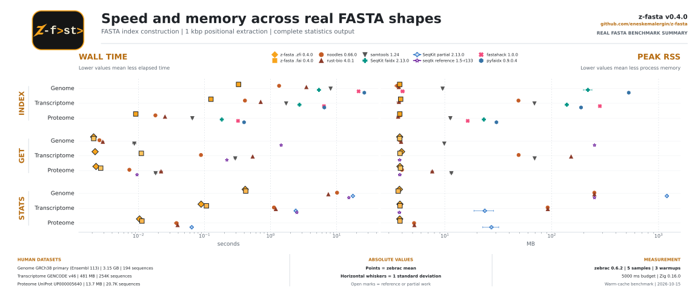
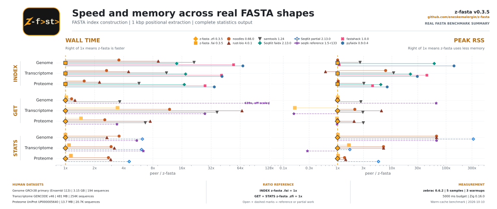
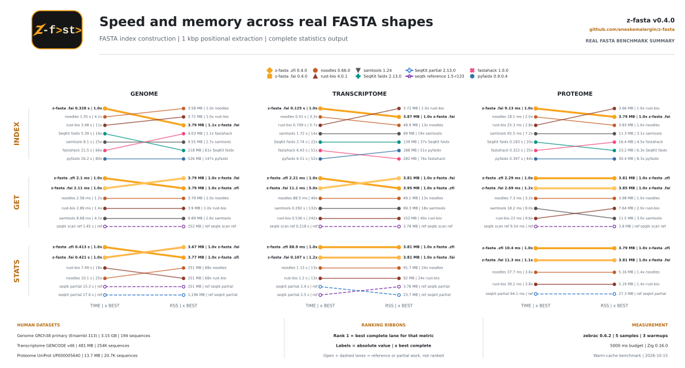

<!-- markdownlint-disable MD033 MD041 -->

# Benchmarking Framework

This is the benchmarking framework for z-fasta. I use it to compare z-fasta with the reference tools across indexing, sequence extraction, stats, and validation. Each suite checks correctness first, then uses [zebrac](https://github.com/eneskemalergin/zebrac) to measure wall time, peak RSS, and page faults.

Zebrac is Linux-only. It is similar to `hyperfine`, but it also records process memory and page faults. It is the runner for the performance sections, not a dependency of z-fasta. The local runner is kept at `tools/zebrac`, separately from the peer-tool installer.

## Published reports

- [Index benchmark report](index/REPORT.md)
- [GET benchmark report](get/REPORT.md)
- [Stats benchmark report](stats/REPORT.md)
- [Validate benchmark report](validate/REPORT.md)

The index, GET, and stats reports and figures describe the measured 0.3.5 runs. The validate report describes the run named in its provenance section.

Each report describes its own methods, field coverage, correctness checks, measurements, and figures. The suites do not all compare the same operation: stats has complete wrapper lanes and partial SeqKit/Seqtk reference lanes, while GET and index have their own compatibility limits.

## How to run

Run these commands from the repository root:

```bash
bash bench/shared/download_data.sh   # fetch the REAL_* datasets once
zig build -Doptimize=ReleaseFast -Dstrip=true  # build the stripped z-fasta subject
tools/install.sh                     # build/install the local peer tools
bash bench/shared/install_tools.sh   # verify the local toolchain

# Full suite: correctness, performance, and report
bash bench/index/run.sh
bash bench/get/run.sh
bash bench/stats/run.sh
bash bench/validate/run.sh

# Correctness only
bash bench/index/run.sh --skip-benchmarks --skip-messy --skip-report
bash bench/get/run.sh --skip-benchmarks --skip-messy --skip-report
bash bench/stats/run.sh --skip-benchmarks --skip-messy --skip-report
bash bench/validate/run.sh --skip-benchmarks --skip-report
```

The GET suite also times the package: `bench/get/library.zig`, which `run.sh` builds with `zig build bench-library`, opens a reference once with `IndexedReader` and fetches the same multi-region and BED sets. It must print what `z-fasta get` prints for each set before that set is timed.

Each suite has one entrypoint: `bash bench/<index|get|stats|validate>/run.sh`. It runs correctness first, then optional zebrac measurements, then writes `REPORT.md`. The suites have different default sample counts and warmups, so check `--help` or the generated report when those details matter.

The benchmark scripts resolve commands from `tools/bin/` by default. Set `SAMTOOLS`, `BEDTOOLS`, `SEQKIT`, or another tool variable when you intentionally want to compare a different executable. `bench/shared/install_tools.sh` only verifies the local bundle and pinned versions; it does not silently fall back to a command found elsewhere on `PATH`.

The v0.3.5 refresh uses Zig 0.16.0 and zebrac 0.6.2 from `PATH`, with `ZEBRAC="$(command -v zebrac)"` passed to each suite. Index, GET, and stats run in that order without overlapping measurements. Each main section uses five measured samples, three warmups, and a 5,000 ms budget per command. The suites' default warmups differ, so pass these settings explicitly. Messy sections retain their separately documented sampling settings. The validate suite runs after stats with the same settings.

The common skips are `--skip-tests` (`--skip-verify`), `--skip-benchmarks` (`--skip-perf`), `--skip-report`, and `--skip-messy`. The last one skips messy performance work only. It does not skip messy correctness cases.

## Refresh reports for a new version

Finish executable changes and run the correctness checks before collecting the release measurements. Build the selected source and check the actual executable version:

```bash
git rev-parse HEAD
zig version
zig build -Doptimize=ReleaseFast -Dstrip=true
zig-out/bin/z-fasta --version
```

Record the committed source, whether it has local changes, binary identity, compiler, build mode, host, input identities and runner settings with the results. The suite manifests record tool versions and sampling settings; they do not alone identify the source commit or prove that the executable matches it. For a comparison, build the earlier source separately and use the same host, inputs and modes. Preserve slower or larger results as well as favorable ones.

Run the full suites sequentially, with the verified zebrac executable:

```bash
ZEBRAC=$(command -v zebrac) bash bench/index/run.sh --runs 5 --warmup 3 --duration 5000
ZEBRAC=$(command -v zebrac) bash bench/get/run.sh --runs 5 --warmup 3 --duration 5000
ZEBRAC=$(command -v zebrac) bash bench/stats/run.sh --runs 5 --warmup 3 --duration 5000
ZEBRAC=$(command -v zebrac) bash bench/validate/run.sh --runs 5 --warmup 3 --duration 5000
```

Check each command's exit status before starting the next suite. Review its manifest, output checks, complete workload set and report before updating README or Wiki summaries. Keep units and measured populations consistent between tables and figures. Do not relabel an older report as the new version. If executable code or the measurement method changes afterward, repeat the affected checks and measurements before regenerating its report.

The correctness-only commands above disable both ordinary and messy measurements and report generation. They cannot supply timing, RSS, allocation, stack or binary-size evidence for a report refresh.

## Feature coverage

Every CLI option and package call, with the Zig tests that cover it (file and test target) and its check on the REAL datasets (suite and section). The REAL checks compare with another tool or an independent count, and run in each suite's correctness pass.

- **Every command**
  - `--help`, `-h`, `--version`, `-V`: `tests/test_diagnostics.zig` (`dispatch`). No REAL check: they print fixed text.
  - `--error-format=json`: `tests/test_diagnostics.zig` and each command's test file (`diagnostics`). REAL: one failure per command, with its code read from the JSON: `index --emit-fai` on a non-uniform layout (`index.nonuniform_fai`), a `get` start past a record (`request.start_after_sequence`) and `--rc` on the proteome (`transform.complement_on_protein`), `stats` with an index older than its FASTA (`index.older_than_source`), and `validate --fix` onto its input (`repair.output_is_input`).
  - `--error-format=text`: `tests/test_diagnostics.zig`. No separate REAL check: the same failures render through the text encoder.
- **index**
  - Default `.zfi`: `tests/test_index.zig` (`index`, `zfi writer`, `zfi loader`). REAL: index suite, a `.zfi` reader written from the format compares every entry with `samtools faidx`.
  - `--emit-fai`: `tests/test_index.zig` (`fai output`). REAL: index suite, byte-identical to `samtools faidx`.
  - `--no-dedup`: `tests/test_index.zig`, `tests/test_library.zig`. No REAL check: the REAL datasets have no duplicate identifiers. The stats suite checks it on a fixture with duplicates (`--no-dedup` keeps more records than the default).
  - `--dedup`: accepted as the default's name since the first release, but not in `--help`, and no test or check covers it.
- **get**
  - Positional regions: `tests/test_get.zig` (`get extraction`, `region resolution`). REAL: GET suite section 6, 100 regions against `samtools faidx`, through `.zfi` and `.fai`.
  - `--names FILE` and `--names -`: `tests/test_get.zig` (`get names`). REAL: section 6, against `samtools faidx -r`, and the same output from standard input.
  - `--bed FILE` and `--bed -`: `tests/test_get.zig` (`get bed`, `bed parser`). REAL: section 6, 1,000 rows against `bedtools getfasta`, and the same output from standard input.
  - `--strand-aware`, `--honor-strand`: `tests/test_get.zig` (`get bed`). REAL: section 6, against `bedtools getfasta -s` on alternating strands.
  - `--rc`: `tests/test_get.zig` (`get`, `get orientation`). REAL: section 6, against `samtools faidx -i`.
  - `--complement-only`, `--reverse-only`: `tests/test_get.zig` (`get`, `get orientation`). REAL: section 6, the complement table and the reversal applied to output already checked against samtools.
  - `--annotate-rc`: `tests/test_get.zig` (`get`, `get bed`). REAL: section 6, every header names the orientation.
  - `--summary`: `tests/test_get.zig`. REAL: section 6, the region count and base total.
- **stats**
  - The report: `tests/test_stats.zig` (`stats`, `stats report`, `sequence type`). REAL: stats suite, the exact oracle on the transcriptome and the proteome through `.zfi` and `.fai`; on the genome, which is too large for the oracle, the `.zfi` and `.fai` reports are identical.
- **validate**
  - The report and exit status: `tests/test_validate.zig` (`validate`, `validate scan`, `validate report`). REAL: validate suite, findings on crafted copies and messy variants, and acceptance agreeing with `index`, samtools, and SeqKit.
  - `--strict`, `--json`: `tests/test_validate.zig` (`validate`, `validate json`). REAL: validate suite, every check reads `--json`; `--strict` on a crafted copy.
  - `--type`, `--custom-alphabet`: `tests/test_validate.zig` (`validate alphabet`, `validate`). REAL: validate suite, the count of bytes outside each alphabet from `grep` and `tr`.
  - `--schema`, `--max-header-len`: `tests/test_validate.zig` (`validate schemas`, `validate scan`, `validate`). REAL: validate suite, mismatching identifiers and long headers counted with `awk`.
  - `--max-name-memory`: `tests/test_validate.zig` (`validate scan`, `validate`). REAL: validate suite, an incomplete report on the transcriptome.
  - `--fix`, `-o`, `--width`: `tests/test_validate.zig` (`validate fix`), `src/validator.zig`. REAL: validate suite, the copy has the same records, lines no wider than the width, and a clean strict validation.
  - `--index`, `--index=PATH`: `tests/test_validate.zig` (`validate index`), `tests/test_index.zig` (`index loader`). REAL: validate suite, every index `index` writes matches, and the named `.fai` is the one compared.
  - `-` (standard input): `tests/test_validate.zig` (`validate`). REAL: validate suite, the same codes and status as from the file.
- **Package**
  - `IndexedReader` (`open`, `recordCount`, `record`, `lookup`, `fetchInto`): `tests/test_library.zig` (`indexed reader`). REAL: GET suite, the package lane prints what `z-fasta get` prints for every multi-region and BED set before it is timed.
  - `RecordReader` (`init`, `next`): `tests/test_library.zig` (`record reader`). REAL: GET suite section 6, every record equals `z-fasta get --names` over every name.
  - `validation.validate`, `validation.repair`: `tests/test_library.zig` (`validation`), `tests/test_validate.zig`. No separate REAL check: `validate` runs the same scan, and the validate suite checks it.

## Source and executable records

New raw metadata and run manifests record `z_fasta_build`: the checkout Git revision and dirty state, plus the executable path, file size, mtime, ctime, device and inode. These cheap file facts do not prove byte equality or that the executable was built from the current checkout. No input hashing is added.

`declared_build` records `BENCH_BUILD_REVISION`, `BENCH_BUILD_ZIG_VERSION`, `BENCH_BUILD_OPTIMIZE` and `BENCH_BUILD_TARGET` when supplied by the builder. Missing facts remain JSON null. The index runner records its own ReleaseFast build mode/compiler and records a revision only for a clean checkout when it builds the default subject. GET/stats use the existing executable and leave undeclared build facts unknown. Report readers retain these records and new reports display them; historical 0.3.4 reports keep their existing labels.

Stats resumes retain a prior verification result only when the recorded source, executable, fixture and peer-tool file facts match and the checkout is clean. Missing records, dirty source or changed file facts leave the resumed run unverified. A timestamp or green log cannot override that result. Historical manifests keep their original report interpretation. These comparisons use file metadata, not byte equality.

## How the tools are built

`tools/install.sh` is the central builder. The shared version coordinates live in [`tools/versions.sh`](../tools/versions.sh), and the installer uses those same values when it downloads, builds, verifies, and publishes the tools.

The installer builds [samtools](https://github.com/samtools/samtools) 1.24 against [HTSlib](https://github.com/samtools/htslib) 1.24, [bedtools](https://github.com/arq5x/bedtools2) 2.31.1, [seqtk](https://github.com/lh3/seqtk) 1.5-r133, and [fastahack](https://github.com/ekg/fastahack) 1.0.0 from their source archives or Git tag. It stages [SeqKit](https://github.com/shenwei356/seqkit) 2.13.0 from its Linux amd64 release binary rather than rebuilding it. It installs [pyfaidx](https://github.com/mdshw5/pyfaidx) 0.9.0.4 plus Matplotlib 3.10.6, pandas 3.0.1, and tabulate 0.10.0 into the local Python environment, then exposes its `faidx` command through `tools/bin/faidx`.

The published commands go under `tools/bin/`. HTSlib shared libraries go under `tools/lib/`. Downloaded sources stay under `tools/src/`, while compiler work, Cargo state, downloaded archives, and the Python package cache stay under `tools/build/`. The virtual environment is `tools/venv/`. The installer stages the compiled command set before publishing it, and samtools carries an origin-relative library path so the published command works without a system `LD_LIBRARY_PATH` setting.

The z-fasta binary is built separately with `zig build -Doptimize=ReleaseFast -Dstrip=true`. `ReleaseFast` selects the optimization mode; `-Dstrip=true` makes the size comparison use the intended stripped executable. Zebrac is also separate: `tools/install.sh` checks that `tools/zebrac` exists, but does not build it. This keeps the benchmark runner distinct from the tools being compared.

## Rust wrappers

[noodles](https://github.com/zaeleus/noodles) and [rust-bio](https://github.com/rust-bio/rust-bio) are Rust libraries, not matching standalone FASTA CLIs. I compile small release-mode adapters so they can participate in the same benchmark contract and emit the output needed by these suites.

The `noodles` binary uses noodles-fasta 0.66.0, including noodles' FAI indexer. The `rustbio` binary uses rust-bio 4.0.1 and its custom strict FAI scanner. Both adapters expose `index`, `get`, and `stats`; GET also covers the shared region, BED, names, and reverse-complement paths that the benchmark exercises. Their `stats` command re-parses clean FASTA and emits the agreed TSV fields. The shared formulas in [`tools/stats_peer.rs`](../tools/stats_peer.rs) are compiled into both binaries. That file is not another executable and the other peer tools do not use it.

These wrappers add argument parsing, indexing or index reading, output formatting, and the benchmark-specific stats path. Their timings and sizes therefore describe the complete wrapper CLIs, not the upstream Rust crates in isolation. The reports call out where a wrapper is custom or where a peer only covers part of the stats contract.

## Binary sizes

These sizes describe the Linux x86_64 tool bundle used for the 0.3.5 reports. Compiler versions, link mode, debug information, stripping, and dependency versions all change the sizes. Every compiled executable in this historical table was stripped. The table compares that build bundle; it does not rank the projects.

| command     | version or implementation                   |                      file size |
| ----------- | ------------------------------------------- | -----------------------------: |
| `z-fasta`   | 0.3.5, Zig `ReleaseFast`, stripped          |        819,416 bytes (800 KiB) |
| `noodles`   | noodles-fasta 0.66.0 wrapper                |        449,712 bytes (439 KiB) |
| `rustbio`   | rust-bio 4.0.1 wrapper                      |        492,712 bytes (481 KiB) |
| `samtools`  | 1.24 with HTSlib 1.24                       |        869,232 bytes (849 KiB) |
| `bedtools`  | 2.31.1                                      |     2,098,216 bytes (2.00 MiB) |
| `seqkit`    | 2.13.0, upstream Linux amd64 release binary |    20,078,754 bytes (19.2 MiB) |
| `seqtk`     | 1.5-r133                                    |        77,600 bytes (75.8 KiB) |
| `fastahack` | 1.0.0                                       |        89,664 bytes (87.6 KiB) |
| `faidx`     | pyfaidx 0.9.0.4                             | symlink, not a compiled binary |
| `zebrac`    | 0.6.2, static stripped binary               |        588,584 bytes (575 KiB) |

The `faidx` entry is intentionally not given a fake binary size: `tools/bin/faidx` is a 17-byte symlink into `tools/venv`, and the actual command is a Python entry point with its environment and installed package outside that link.

## What the numbers do and do not say

I tried to keep the timed paths direct. GET indexes are prepared before zebrac runs, and stats indexes are preloaded before the timed stats commands. The runners do not add an intentional sleep or throttle. Correctness runs remain separate from performance runs, and the reports record the zebrac samples, warmups, duration, tool versions, and workload metadata.

That still does not prove that every lane has identical overhead. The Rust adapters add a CLI and output layer by design. z-fasta has separate `.zfi` and `.fai` paths, and some peers only support a subset of the requested operation. A benchmark may also expose an implementation bottleneck or an accidental headroom that I have not found yet. Read the results as measurements of these concrete commands and inputs, with the scope notes in each report, rather than as a claim about the underlying libraries in the abstract.

Helpers live in `bench/shared/` (`tools.sh`, `zebrac_runner.sh`, `runner_common.sh`, `download_data.sh`, `install_tools.sh`, `generate_messy.py`, and `generate_scaling.py`). Generated fixtures under `bench/*/data/` and `bench/shared/cache/` are gitignored. Materialize them with `python3 bench/shared/generate_messy.py` and `python3 bench/shared/generate_scaling.py`; use `--force` after changing their parameters. After a full regeneration, commit each suite's `REPORT.md` with its `results/figures/*.png` files so the reports still render on GitHub.

GET messy performance is heavy. Use the skip flags while iterating, then run the full suites before a release tag.

## v0.3.5 measurements

The refresh compares matched z-fasta commands with the v0.3.4 runs from 2026-10-07 on the same host. A wall-time increase is flagged when it exceeds both 10% and 1 ms; an RSS increase is flagged when it exceeds both 10% and 1 MiB. Peer commands also moved by up to a few percent between the two sessions, so small differences do not isolate code changes.

The checks cover 30 index, 118 GET, and 28 stats measurements for z-fasta. 26 wall-time increases and one RSS increase cross the thresholds:

- **Index:** 15 of 30 cases, from 10% to 40% slower, with peak RSS within 0.4 MiB. Human genome `.fai` takes 382.4 ms (previously 321.2 ms); the 1,000,000-sequence scaling input takes 445.8 ms (previously 317.5 ms). 0.3.5 adds coded diagnostics to indexing and validates whitespace before accepting fixed-width records; this run does not attribute the increase to either change.
- **GET:** ten transcriptome `.zfi` cases take 1.2 to 1.9 ms longer, such as the 1 kbp region at 8.2 ms (previously 6.3 ms), plus one genome `.fai` batch of 10,000 BED rows at 18.8 ms (previously 16.8 ms). Genome and proteome positional GET stay within the thresholds.
- **Stats:** the 500,000-sequence `.fai` scaling input uses 39.0 MiB (previously 35.0 MiB). Stats times stay within the thresholds.

Transcriptome `.fai` stats uses less memory: 20.2 MiB, down from 23.7 MiB. Index, GET, and stats remain faster than every reported peer on all three real datasets.

---

## High-level benchmark summary figures

The individual reports above are the source for methods, correctness checks, commands, uncertainty, and the larger benchmark sections. I still wanted a smaller set of figures that gives me a useful overview before I open those reports. A single chart was not enough: absolute measurements, relative differences, and speed-memory tradeoffs answer different questions and can contradict each other in important ways.

These three views therefore use the same selected index, GET, and stats runs but organize them differently. Every view keeps wall time beside peak RSS, covers the same human genome, transcriptome, and proteome inputs, and identifies partial or reference work instead of quietly ranking it as equivalent. They are not three independent benchmark claims and they are not a combined winner score.

The selected v0.3.5 runs are index `20261010_140037`, GET `20261010_143023`, and stats `20261010_143519`. Summary RSS uses decimal MB (1,000,000 bytes); the individual reports use MiB (1,048,576 bytes). GET summaries select a single 1 kbp positional request. The seekable BED and names changes in [#14](https://github.com/eneskemalergin/z-fasta/issues/14) affect batch lookup; their measurements are in the [GET report](get/REPORT.md#performance-bed-batch).

GitHub selects the dark or light SVG to match the reader's color scheme.

Regenerate the six SVGs from the selected raw runs configured in `summary/src/representation_common.py` with the existing local Python environment:

```bash
tools/venv/bin/python bench/summary/src/render_01_absolute_matrix.py
tools/venv/bin/python bench/summary/src/render_02_zfasta_reference.py
tools/venv/bin/python bench/summary/src/render_03_ranking_ribbons.py
```

### Absolute measurements

I use this view when I want to know the practical cost of a command. It shows the measured wall time in seconds and peak process memory in MB on logarithmic axes, with the tools kept in their real units rather than normalized to z-fasta. The points are zebrac means and the horizontal whiskers are one standard deviation.

This is the important counterweight to the ratio view: a large relative difference can still describe two very small absolute times, while similar runtimes can hide a large memory difference.

<picture>
  <source media="(prefers-color-scheme: dark)" srcset="summary/01-absolute-matrix-dark.svg">
  <source media="(prefers-color-scheme: light)" srcset="summary/01-absolute-matrix-light.svg">
  
</picture>

### z-fasta reference ratios

This view asks how far each measured lane sits from the relevant z-fasta path for the same task and dataset. Index uses z-fasta `.fai` as `1x`; GET and stats use z-fasta `.zfi` as `1x`. A peer to the right of `1x` took more time or memory than that baseline, while a point to the left used less.

Normalization makes the size of a difference easy to scan across workloads with very different absolute scales. It does not replace the absolute plot, and it does not turn partial stats or scan-based reference lanes into equivalent work; those lanes remain open and dashed.

<picture>
  <source media="(prefers-color-scheme: dark)" srcset="summary/02-zfasta-reference-dark.svg">
  <source media="(prefers-color-scheme: light)" srcset="summary/02-zfasta-reference-light.svg">
  
</picture>

### Ranking ribbons

The ribbons show whether a tool's position changes between speed and memory. Complete lanes are ranked independently for wall time and peak RSS within each task and dataset, then connected across the two rankings. Rank `1` is the best complete lane for that metric, and each label retains both the absolute value and the multiple over the best complete result. Exact ties share a rank; their labels are separated vertically for readability.

I find this useful when a tool is fast but memory-heavy, or memory-flat but slower, because that tradeoff is visible as a crossing ribbon instead of being flattened into one score. Partial and reference lanes are displayed for context but remain outside the complete ranking.

<picture>
  <source media="(prefers-color-scheme: dark)" srcset="summary/03-ranking-ribbons-dark.svg">
  <source media="(prefers-color-scheme: light)" srcset="summary/03-ranking-ribbons-light.svg">
  
</picture>

All six light and dark SVGs are generated from the benchmark results and version coordinates in this repository. Regenerate the editable outputs from the repository root:

```bash
python3 bench/summary/src/render_01_absolute_matrix.py
python3 bench/summary/src/render_02_zfasta_reference.py
python3 bench/summary/src/render_03_ranking_ribbons.py
```
