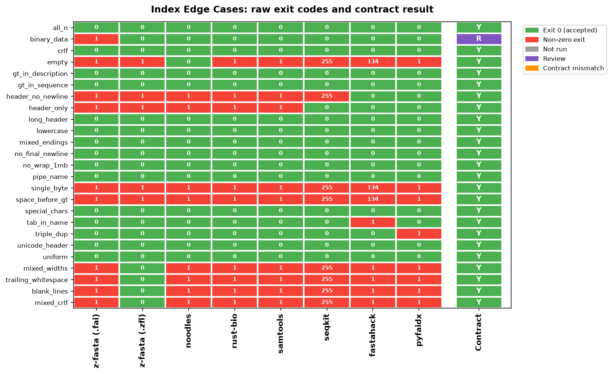
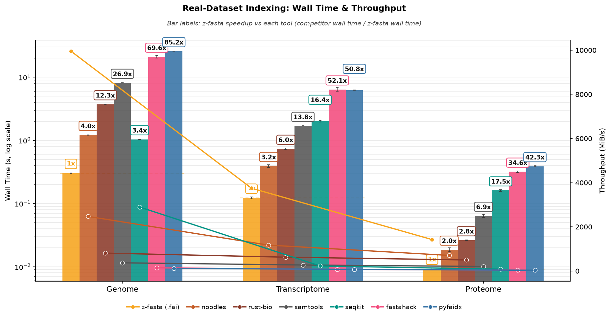
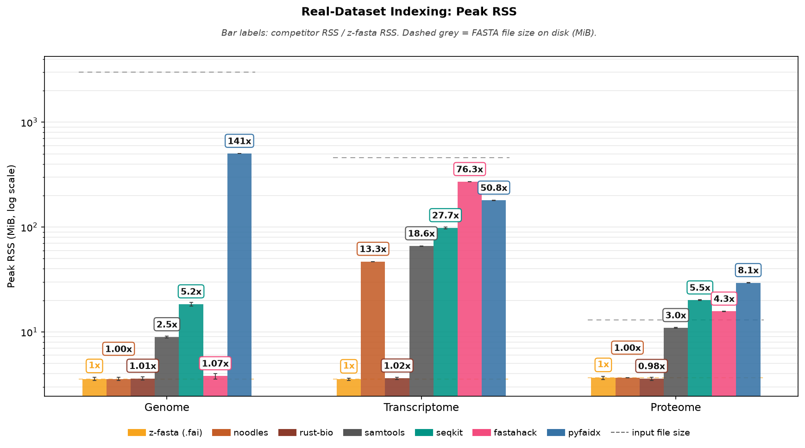
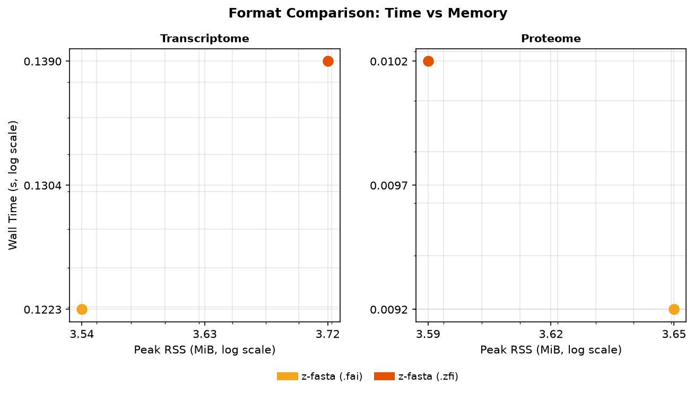
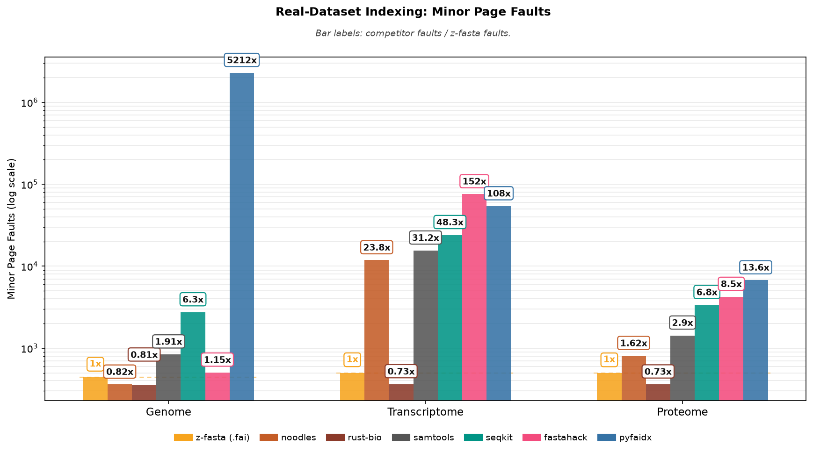
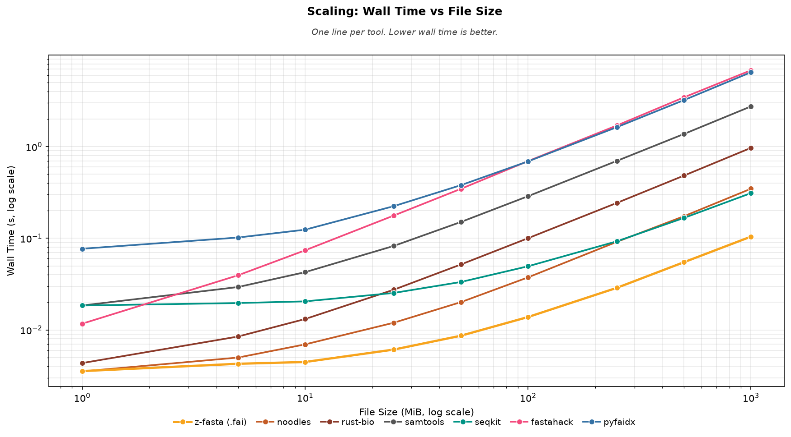
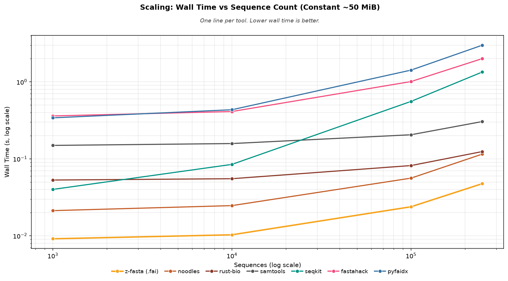
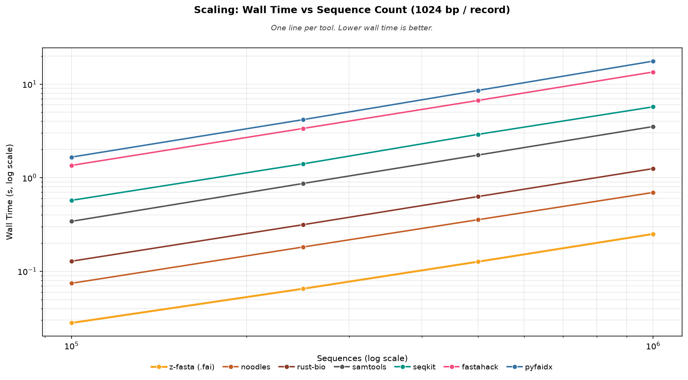

<!-- markdownlint-disable MD024 MD032 MD033 MD036 MD041 MD049 -->

# z-fasta Index Benchmark Report

_Auto-generated by `generate_report.py` from zebrac results._

## Overview

This report presents the benchmark sections captured by the selected run: correctness, real-data performance and memory, the two output formats, and synthetic scaling where available.

Cross-tool tables use `z-fasta index --emit-fai` because the peer tools write samtools-compatible `.fai` indexes. The z-fasta-only comparison separately covers `.fai` and the default `.zfi` on Transcriptome and Proteome.

The **rust-bio** label needs one clarification: rust-bio has no equivalent standalone FAI index command, so this benchmark lane uses the strict custom Rust FAI writer in the rust-bio wrapper. The label stays short in tables and figures, but the measured indexing code is custom.

Correctness covers strict FAI compatibility and z-fasta's `.zfi` support for ragged wrapping, trailing spaces, blank lines, and mixed line endings.

## Run Provenance

- **Build:** z-fasta v0.4.1; Zig 0.16.0; ReleaseFast; `x86_64-linux`.
- **Benchmark:** zebrac v0.6.2; warm cache; 5 measured samples after 3 warmups; 5000 ms budget per command.
**Source and executable facts**

```json
{
  "checkout_revision": "52483244ac933df5e6f7901cb492c5059b5aa4ba",
  "checkout_dirty": true,
  "executable": {
    "path": "zig-out/bin/z-fasta",
    "size": 933608,
    "mtime_ns": 1795317893551889311,
    "ctime_ns": 1795318050878056176,
    "device": 50,
    "inode": 199116288
  },
  "declared_build": {
    "revision": null,
    "zig_version": "0.16.0",
    "optimize": "ReleaseFast",
    "target": "x86_64-linux.5.10...6.19-gnu.2.43"
  }
}
```

## Datasets

- **Genome:** Homo sapiens GRCh38 primary assembly (Ensembl release 113).
- **Transcriptome:** Homo sapiens GENCODE v46 transcript sequences.
- **Proteome:** Homo sapiens UniProt reference proteome UP000005640.

## Tools Tested

- **z-fasta (v0.4.1)**
  - `.fai`: peer-comparable cross-tool and scaling lane.
  - `.zfi`: default product mode.
- **noodles (v0.69.0)**: Rust noodles-fasta wrapper.
- **rust-bio (v4.2.2)**: Rust FASTA library.
- **samtools (v1.25)**: reference FAI indexer.
- **seqkit (v2.14.0)**: Go FASTA toolkit.
- **fastahack (v1.0.0)**: C++ FAI indexer.
- **pyfaidx (v0.9.2.3)**: Python FAI indexer.

## Edge Case Correctness

Each heatmap row is one structural FASTA edge case. The z-fasta columns separate the samtools-compatible FAI attempt from the production `.zfi` index. The **Contract** column marks whether z-fasta met that test's rules.

**Contract meaning:** for structural cases, `z-fasta (.fai)` must agree with samtools on FAI acceptance and bytes when both accept. If one accepts and the other rejects, the contract is `N`. For the four named messy fixtures, the `.zfi` side-table path is the contract because samtools cannot represent those layouts; the FAI rejection pair plus valid `.zfi` side table is `Y`.

**Scoring rules:**

- *Samtools parity* cases: when both z-fasta and samtools accept a file, their `.fai` output must match. When both reject it, that also counts as a match. A production `.zfi` success does not hide an FAI exit-code mismatch.

- *z-fasta-only* messy cases: z-fasta must index files where samtools rejects non-uniform wrapping (side-table `.zfi`).

**Table 1:** Comparability summary by contract class. Raw exit codes are diagnostic; `Result` applies the class-specific comparison rule.

| Contract basis       |   Cases | Result     | Comparison                                                    |
|:---------------------|--------:|:-----------|:--------------------------------------------------------------|
| FAI parity           |      19 | 19/19 pass | z-fasta (.fai) vs samtools acceptance and FAI bytes           |
| ZFI messy support    |       4 | 4/4 pass   | z-fasta (.zfi) side table; FAI peers expected incompatible    |
| Invalid input review |       1 | 1/1 review | raw behavior shown; no parity claim for binary input          |
| Every record indexed |       1 | 1/1 pass   | z-fasta (.fai) keeps each duplicate; samtools keeps the first |

<div style="margin: 1.5em 0"></div>

**Figure 1:** Raw per-test exit codes and the composite contract result. Green = exit 0; red = non-zero exit; gray = tool not run; purple = review; orange = contract mismatch.



**Reading Figure 1**
- Rows: structural FASTA edge cases.
- Tool columns show the numeric exit code; `n/a` means the optional tool was not run.
- **Contract:** `Y` = match, `R` = review, `N` = mismatch.
- Cell colors match the legend on the chart.
- Aggregate counts are in Table 1.

## Messy FASTA Compatibility

Proteome-derived messy FASTA fixtures. Each cell is zebrac with `--allow-failures` (repeated samples, not a single exit check).

**z-fasta lane:** This table must use `z-fasta (.zfi)` via default `index`. The `.fai` lane is not the messy compatibility claim; variable widths, trailing whitespace, and mixed line endings require the production `.zfi` side table.

**What z-fasta handles:** irregular line wrapping, trailing whitespace on sequence lines, blank lines between records, and mixed CRLF/LF. Those are common export glitches, not arbitrary byte corruption. z-fasta records true sequence boundaries in a side-table `.zfi` instead of assuming every line in a record has the same width.

**What we still reject:** empty files, headers without sequence, malformed headers, and other cases where indexing would be meaningless (see **Edge Case Correctness** above). We do not claim to repair truncated or binary-corrupted FASTA.

`mixed_crlf` deliberately alternates LF and CRLF sequence-line endings. It is not a uniformly CRLF-wrapped control file.

**Table 2:** Measured process result per variant and tool from the messy benchmark data. The z-fasta `.zfi` lane is `ok` only when every sample exits 0. Peer cells report only whether every measured sample exited 0; they do not claim sequence-retrieval compatibility.

| Variant             | z-fasta (.zfi)   | noodles   | rust-bio   | samtools   | seqkit   | fastahack   | pyfaidx   |
|:--------------------|:-----------------|:----------|:-----------|:-----------|:---------|:------------|:----------|
| all_messy           | ok               | nonzero   | nonzero    | nonzero    | nonzero  | nonzero     | nonzero   |
| mixed_crlf          | ok               | nonzero   | exit 0     | nonzero    | nonzero  | nonzero     | nonzero   |
| mixed_widths        | ok               | nonzero   | nonzero    | nonzero    | nonzero  | nonzero     | nonzero   |
| trailing_whitespace | ok               | nonzero   | nonzero    | nonzero    | nonzero  | nonzero     | nonzero   |

**Reading Table 2**
- Rows: messy variant names (`all_messy`, `mixed_crlf`, `mixed_widths`, `trailing_whitespace`).
- Columns: production `z-fasta (.zfi)` followed by FAI peers.
- `exit 0` and `nonzero` are measured process results, not output validation.

## Performance: Real Datasets

Headline comparison on the three human reference datasets (see **Datasets**). **z-fasta (.fai)** is `index --emit-fai`. It constructs the peer-compatible output while discarding the emitted stream; peers write sidecar files, so output destinations are not identical. CLI default `index` writes `.zfi`; see **z-fasta Format Comparison**.

**Measured result:** z-fasta is faster than every reported peer on Genome, Transcriptome, and Proteome. The narrowest lead is 2.02x against noodles on Proteome.

**Table 3:** Zebrac wall time per dataset (seconds, mean ± stddev, warm cache). Lower is better. Tool order: z-fasta, noodles, rust-bio, samtools, seqkit, fastahack, pyfaidx.

| dataset       | z-fasta (.fai)   | noodles         | rust-bio        | samtools        | seqkit          | fastahack        | pyfaidx          |
|:--------------|:-----------------|:----------------|:----------------|:----------------|:----------------|:-----------------|:-----------------|
| Genome        | 0.3019s ±0.0041  | 1.2163s ±0.0044 | 3.7115s ±0.0386 | 8.1222s ±0.0299 | 1.0376s ±0.0066 | 21.0010s ±0.9892 | 25.7154s ±0.0956 |
| Transcriptome | 0.1223s ±0.0042  | 0.3917s ±0.0196 | 0.7330s ±0.0239 | 1.6906s ±0.0155 | 2.0100s ±0.0547 | 6.3782s ±0.4224  | 6.2162s ±0.0373  |
| Proteome      | 0.0092s ±0.0004  | 0.0185s ±0.0013 | 0.0262s ±0.0004 | 0.0636s ±0.0040 | 0.1610s ±0.0044 | 0.3184s ±0.0084  | 0.3890s ±0.0056  |

<details>

<summary><strong>Table 4:</strong> Input throughput (MiB/s), calculated from input size and wall time. Higher is better. Same tools and order as Table 3.</summary>

| dataset       | z-fasta (.fai)   | noodles      | rust-bio    | samtools    | seqkit       | fastahack   | pyfaidx     |
|:--------------|:-----------------|:-------------|:------------|:------------|:-------------|:------------|:------------|
| Genome        | 9955.5 MiB/s     | 2471.0 MiB/s | 809.8 MiB/s | 370.0 MiB/s | 2896.4 MiB/s | 143.1 MiB/s | 116.9 MiB/s |
| Transcriptome | 3749.4 MiB/s     | 1171.2 MiB/s | 625.8 MiB/s | 271.3 MiB/s | 228.2 MiB/s  | 71.9 MiB/s  | 73.8 MiB/s  |
| Proteome      | 1423.5 MiB/s     | 706.4 MiB/s  | 500.5 MiB/s | 206.0 MiB/s | 81.4 MiB/s   | 41.1 MiB/s  | 33.7 MiB/s  |

</details>

<details>

<summary><strong>Table 5:</strong> z-fasta vs each competitor. Speedup = competitor wall time / z-fasta wall time (higher = z-fasta faster). Same ratios appear as bar labels on Figure 2. Throughput ratio uses MiB/s.</summary>

| Dataset       | z-fasta vs   | z-fasta   | Competitor   | Speedup   |   z-fasta MiB/s |   Competitor MiB/s | Throughput ratio   |
|:--------------|:-------------|:----------|:-------------|:----------|----------------:|-------------------:|:-------------------|
| Genome        | noodles      | 0.3019s   | 1.2163s      | 4.0x      |          9955.5 |             2471   | 4.0x               |
| Genome        | rust-bio     | 0.3019s   | 3.7115s      | 12.3x     |          9955.5 |              809.8 | 12.3x              |
| Genome        | samtools     | 0.3019s   | 8.1222s      | 26.9x     |          9955.5 |              370   | 26.9x              |
| Genome        | seqkit       | 0.3019s   | 1.0376s      | 3.4x      |          9955.5 |             2896.4 | 3.4x               |
| Genome        | fastahack    | 0.3019s   | 21.0010s     | 69.6x     |          9955.5 |              143.1 | 69.6x              |
| Genome        | pyfaidx      | 0.3019s   | 25.7154s     | 85.2x     |          9955.5 |              116.9 | 85.2x              |
| Transcriptome | noodles      | 0.1223s   | 0.3917s      | 3.2x      |          3749.4 |             1171.2 | 3.2x               |
| Transcriptome | rust-bio     | 0.1223s   | 0.7330s      | 6.0x      |          3749.4 |              625.8 | 6.0x               |
| Transcriptome | samtools     | 0.1223s   | 1.6906s      | 13.8x     |          3749.4 |              271.3 | 13.8x              |
| Transcriptome | seqkit       | 0.1223s   | 2.0100s      | 16.4x     |          3749.4 |              228.2 | 16.4x              |
| Transcriptome | fastahack    | 0.1223s   | 6.3782s      | 52.1x     |          3749.4 |               71.9 | 52.1x              |
| Transcriptome | pyfaidx      | 0.1223s   | 6.2162s      | 50.8x     |          3749.4 |               73.8 | 50.8x              |
| Proteome      | noodles      | 0.0092s   | 0.0185s      | 2.0x      |          1423.5 |              706.4 | 2.0x               |
| Proteome      | rust-bio     | 0.0092s   | 0.0262s      | 2.8x      |          1423.5 |              500.5 | 2.8x               |
| Proteome      | samtools     | 0.0092s   | 0.0636s      | 6.9x      |          1423.5 |              206   | 6.9x               |
| Proteome      | seqkit       | 0.0092s   | 0.1610s      | 17.5x     |          1423.5 |               81.4 | 17.5x              |
| Proteome      | fastahack    | 0.0092s   | 0.3184s      | 34.6x     |          1423.5 |               41.1 | 34.6x              |
| Proteome      | pyfaidx      | 0.0092s   | 0.3890s      | 42.3x     |          1423.5 |               33.7 | 42.3x              |

</details>

<div style="margin: 1.5em 0"></div>

**Figure 2:** Dual-axis chart for Table 3 and Table 4. Bars show wall time (left axis, log scale). Lines and markers show throughput (right axis). Legend colors: gold = z-fasta; bronze = noodles; red-brown = rust-bio; grey = samtools; teal = seqkit; pink = fastahack; blue = pyfaidx. Bar labels show z-fasta speedup vs each tool (see Table 5); gold dashed line = z-fasta wall time per dataset.



**Reading Figure 2**
- **Bars (left):** zebrac mean wall time. Error bars are one standard deviation.
- **Lines and markers (right):** input MiB/s for the same tool at each dataset.
- **Legend order:** z-fasta, noodles, rust-bio, samtools, seqkit, fastahack, pyfaidx.
- **Bar labels:** `1x` on z-fasta (baseline); competitor labels = z-fasta speedup (competitor time / z-fasta time). Border color matches the tool. Dashed gold line = z-fasta wall time for that dataset. Details in Table 5.
- **z-fasta only:** this section uses the peer-comparable `.fai` lane; format tradeoffs are in **z-fasta Format Comparison**.

## Memory Usage: Real Datasets

Same zebrac runs as **Performance: Real Datasets**. z-fasta (.fai) only; the `.zfi` lane is in **z-fasta Format Comparison**.

**Measured result:** rust-bio uses less peak RSS on Proteome (3.59 MiB vs 3.65 MiB).

### Peak RSS

zebrac starts a new process for each sample and records peak RSS when it exits. That is the most RAM the process had in use at once (Linux `ru_maxrss` via `getrusage`). Table and figure show the mean across samples.

Use this to compare tools on the same file and host. Grey dashed lines show file size as context; the output format can still affect memory. A low bar does not always mean less work, so wall time and page faults provide the surrounding context.

**Table 6:** Peak RSS (MiB, zebrac mean). Same tool order as Performance.

| dataset       | z-fasta (.fai)   | noodles   | rust-bio   | samtools   | seqkit    | fastahack   | pyfaidx    |
|:--------------|:-----------------|:----------|:-----------|:-----------|:----------|:------------|:-----------|
| Genome        | 3.57 MiB         | 3.57 MiB  | 3.60 MiB   | 8.96 MiB   | 18.43 MiB | 3.80 MiB    | 501.74 MiB |
| Transcriptome | 3.54 MiB         | 46.90 MiB | 3.62 MiB   | 65.92 MiB  | 98.20 MiB | 269.99 MiB  | 179.70 MiB |
| Proteome      | 3.65 MiB         | 3.66 MiB  | 3.59 MiB   | 10.95 MiB  | 20.08 MiB | 15.72 MiB   | 29.40 MiB  |

<details>

<summary><strong>Table 7:</strong> z-fasta vs each competitor. RSS ratio = competitor peak RSS / z-fasta peak RSS. Same ratios as bar labels on Figure 3.</summary>

| Dataset       | z-fasta vs   | z-fasta   | Competitor   | RSS ratio   |
|:--------------|:-------------|:----------|:-------------|:------------|
| Genome        | noodles      | 3.57 MiB  | 3.57 MiB     | 1.00x       |
| Genome        | rust-bio     | 3.57 MiB  | 3.60 MiB     | 1.01x       |
| Genome        | samtools     | 3.57 MiB  | 8.96 MiB     | 2.5x        |
| Genome        | seqkit       | 3.57 MiB  | 18.43 MiB    | 5.2x        |
| Genome        | fastahack    | 3.57 MiB  | 3.80 MiB     | 1.07x       |
| Genome        | pyfaidx      | 3.57 MiB  | 501.74 MiB   | 141x        |
| Transcriptome | noodles      | 3.54 MiB  | 46.90 MiB    | 13.3x       |
| Transcriptome | rust-bio     | 3.54 MiB  | 3.62 MiB     | 1.02x       |
| Transcriptome | samtools     | 3.54 MiB  | 65.92 MiB    | 18.6x       |
| Transcriptome | seqkit       | 3.54 MiB  | 98.20 MiB    | 27.7x       |
| Transcriptome | fastahack    | 3.54 MiB  | 269.99 MiB   | 76.3x       |
| Transcriptome | pyfaidx      | 3.54 MiB  | 179.70 MiB   | 50.8x       |
| Proteome      | noodles      | 3.65 MiB  | 3.66 MiB     | 1.00x       |
| Proteome      | rust-bio     | 3.65 MiB  | 3.59 MiB     | 0.98x       |
| Proteome      | samtools     | 3.65 MiB  | 10.95 MiB    | 3.0x        |
| Proteome      | seqkit       | 3.65 MiB  | 20.08 MiB    | 5.5x        |
| Proteome      | fastahack    | 3.65 MiB  | 15.72 MiB    | 4.3x        |
| Proteome      | pyfaidx      | 3.65 MiB  | 29.40 MiB    | 8.1x        |

</details>

<div style="margin: 1.5em 0"></div>

**Figure 3:** Table 6 as grouped bars (log scale). Bar labels = RSS ratio (see Table 7). Gold dashed line = z-fasta RSS; grey dashed = FASTA file size on disk.



**Reading Figure 3**
- Bars: mean peak RSS. `1x` on z-fasta; other labels = competitor / z-fasta.
- Gold dashed line: z-fasta RSS for that dataset.
- Grey dashed line: input FASTA size.
- Details in Table 7.

## z-fasta Format Comparison

This focused z-fasta comparison uses **Transcriptome** and **Proteome**. It isolates the output format: `.fai` from `index --emit-fai`, and the default `.zfi`. Peer indexers stay in the cross-tool performance sections, where they answer a different question.

**Table 8:** Measured wall time and peak RSS for each format. Each ratio is `.zfi` divided by `.fai` within the same dataset.

| Dataset       | .fai wall       | .zfi wall       | Wall ratio   | .fai RSS   | .zfi RSS   | RSS ratio   |
|:--------------|:----------------|:----------------|:-------------|:-----------|:-----------|:------------|
| Transcriptome | 0.1223s ±0.0042 | 0.1390s ±0.0016 | 1.14x        | 3.54 MiB   | 3.72 MiB   | 1.05x       |
| Proteome      | 0.0092s ±0.0004 | 0.0102s ±0.0002 | 1.10x        | 3.65 MiB   | 3.59 MiB   | 0.98x       |

<div style="margin: 1.5em 0"></div>

**Figure 4:** The same measured configurations plotted by peak RSS and wall time. Both axes use log scale; lower-left is faster with less process memory.



**Reading Figure 4**
- Panels: Transcriptome and Proteome.
- Gold points: `.fai`; orange points: `.zfi`.
- Exact measurements and ratios are in Table 8.

## Page Faults: Real Datasets

Same zebrac samples as the real-dataset performance and memory sections.

### Page faults

A **minor** fault maps a page without reading disk. A **major** fault reads from disk. zebrac reports both per run, like wall time. Table 11 lists major faults separately.

**Table 9:** Minor page faults (zebrac mean). Same tool order as Performance.

| dataset       |   z-fasta (.fai) |   noodles |   rust-bio |   samtools |   seqkit |   fastahack |   pyfaidx |
|:--------------|-----------------:|----------:|-----------:|-----------:|---------:|------------:|----------:|
| Genome        |              439 |       360 |        355 |        840 |    2,749 |         504 | 2,292,139 |
| Transcriptome |              498 |    11,865 |        363 |     15,575 |   24,080 |      75,990 |    54,076 |
| Proteome      |              497 |       805 |        361 |      1,429 |    3,371 |       4,246 |     6,753 |

<details>

<summary><strong>Table 10:</strong> z-fasta vs each competitor. Faults ratio = competitor minor faults / z-fasta minor faults. Same ratios as bar labels on Figure 5.</summary>

| Dataset       | z-fasta vs   |   z-fasta |   Competitor | Faults ratio   |
|:--------------|:-------------|----------:|-------------:|:---------------|
| Genome        | noodles      |       439 |          360 | 0.82x          |
| Genome        | rust-bio     |       439 |          355 | 0.81x          |
| Genome        | samtools     |       439 |          840 | 1.91x          |
| Genome        | seqkit       |       439 |        2,749 | 6.3x           |
| Genome        | fastahack    |       439 |          504 | 1.15x          |
| Genome        | pyfaidx      |       439 |    2,292,139 | 5212x          |
| Transcriptome | noodles      |       498 |       11,865 | 23.8x          |
| Transcriptome | rust-bio     |       498 |          363 | 0.73x          |
| Transcriptome | samtools     |       498 |       15,575 | 31.2x          |
| Transcriptome | seqkit       |       498 |       24,080 | 48.3x          |
| Transcriptome | fastahack    |       498 |       75,990 | 152x           |
| Transcriptome | pyfaidx      |       498 |       54,076 | 108x           |
| Proteome      | noodles      |       497 |          805 | 1.62x          |
| Proteome      | rust-bio     |       497 |          361 | 0.73x          |
| Proteome      | samtools     |       497 |        1,429 | 2.9x           |
| Proteome      | seqkit       |       497 |        3,371 | 6.8x           |
| Proteome      | fastahack    |       497 |        4,246 | 8.5x           |
| Proteome      | pyfaidx      |       497 |        6,753 | 13.6x          |

</details>

<details>

<summary><strong>Table 11:</strong> Major page faults.</summary>

| dataset       |   z-fasta (.fai) |   noodles |   rust-bio |   samtools |   seqkit |   fastahack |   pyfaidx |
|:--------------|-----------------:|----------:|-----------:|-----------:|---------:|------------:|----------:|
| Genome        |                0 |         0 |          0 |          0 |        0 |           0 |         0 |
| Transcriptome |                0 |         0 |          0 |          0 |        0 |           0 |         0 |
| Proteome      |                0 |         0 |          0 |          0 |        0 |           0 |         0 |

</details>

<div style="margin: 1.5em 0"></div>

**Figure 5:** Table 9 as grouped bars (log scale). Bar labels = Faults ratio (see Table 10). Gold dashed line = z-fasta minor faults.



**Reading Figure 5**
- Bars: mean minor faults. `1x` on z-fasta; other labels = competitor / z-fasta.
- Gold dashed line: z-fasta count for that dataset.
- Lower bar = fewer minor faults.
- Details in Table 10.

## Scaling: File Size

Synthetic FASTA files from 1 MiB to 1000 MiB with 100 sequences per file. Uses the zebrac warm-cache setup in **Run Provenance** and the peer-comparable z-fasta `.fai` lane.

**Measured result:** faster than z-fasta: noodles at 1 MiB.

### Wall time vs file size

Mean wall time (seconds, zebrac) at each file size. **Lower is better.** Record count stays fixed at 100 while total bytes on disk grow.

<details>

<summary><strong>Table 12:</strong> Wall time per file size (zebrac mean, seconds). Tool order: z-fasta, noodles, rust-bio, samtools, seqkit, fastahack, pyfaidx.</summary>

| File Size   |   z-fasta (.fai) |   noodles |   rust-bio |   samtools |   seqkit |   fastahack |   pyfaidx |
|:------------|-----------------:|----------:|-----------:|-----------:|---------:|------------:|----------:|
| 1 MiB       |           0.0036 |    0.0035 |     0.0043 |     0.0185 |   0.0185 |      0.0117 |    0.0769 |
| 5 MiB       |           0.0043 |    0.0050 |     0.0085 |     0.0294 |   0.0197 |      0.0395 |    0.1019 |
| 10 MiB      |           0.0045 |    0.0070 |     0.0132 |     0.0427 |   0.0205 |      0.0740 |    0.1241 |
| 25 MiB      |           0.0061 |    0.0120 |     0.0275 |     0.0826 |   0.0253 |      0.1772 |    0.2242 |
| 50 MiB      |           0.0086 |    0.0201 |     0.0518 |     0.1508 |   0.0334 |      0.3467 |    0.3800 |
| 100 MiB     |           0.0138 |    0.0375 |     0.1002 |     0.2880 |   0.0495 |      0.6956 |    0.6909 |
| 250 MiB     |           0.0288 |    0.0914 |     0.2430 |     0.6987 |   0.0926 |      1.7001 |    1.6300 |
| 500 MiB     |           0.0548 |    0.1740 |     0.4828 |     1.3737 |   0.1667 |      3.4481 |    3.2171 |
| 1000 MiB    |           0.1043 |    0.3474 |     0.9700 |     2.7489 |   0.3112 |      6.8124 |    6.4848 |

</details>

<details>

<summary><strong>Table 13:</strong> z-fasta vs each competitor at each file size. Time ratio = competitor wall time / z-fasta wall time.</summary>

| File Size   | z-fasta vs   | z-fasta   | Competitor   | Time ratio   |
|:------------|:-------------|:----------|:-------------|:-------------|
| 1 MiB       | noodles      | 0.0036s   | 0.0035s      | 0.99x        |
| 1 MiB       | rust-bio     | 0.0036s   | 0.0043s      | 1.22x        |
| 1 MiB       | samtools     | 0.0036s   | 0.0185s      | 5.2x         |
| 1 MiB       | seqkit       | 0.0036s   | 0.0185s      | 5.2x         |
| 1 MiB       | fastahack    | 0.0036s   | 0.0117s      | 3.3x         |
| 1 MiB       | pyfaidx      | 0.0036s   | 0.0769s      | 21.6x        |
| 5 MiB       | noodles      | 0.0043s   | 0.0050s      | 1.17x        |
| 5 MiB       | rust-bio     | 0.0043s   | 0.0085s      | 1.98x        |
| 5 MiB       | samtools     | 0.0043s   | 0.0294s      | 6.9x         |
| 5 MiB       | seqkit       | 0.0043s   | 0.0197s      | 4.6x         |
| 5 MiB       | fastahack    | 0.0043s   | 0.0395s      | 9.2x         |
| 5 MiB       | pyfaidx      | 0.0043s   | 0.1019s      | 23.9x        |
| 10 MiB      | noodles      | 0.0045s   | 0.0070s      | 1.56x        |
| 10 MiB      | rust-bio     | 0.0045s   | 0.0132s      | 2.9x         |
| 10 MiB      | samtools     | 0.0045s   | 0.0427s      | 9.6x         |
| 10 MiB      | seqkit       | 0.0045s   | 0.0205s      | 4.6x         |
| 10 MiB      | fastahack    | 0.0045s   | 0.0740s      | 16.6x        |
| 10 MiB      | pyfaidx      | 0.0045s   | 0.1241s      | 27.8x        |
| 25 MiB      | noodles      | 0.0061s   | 0.0120s      | 1.96x        |
| 25 MiB      | rust-bio     | 0.0061s   | 0.0275s      | 4.5x         |
| 25 MiB      | samtools     | 0.0061s   | 0.0826s      | 13.5x        |
| 25 MiB      | seqkit       | 0.0061s   | 0.0253s      | 4.1x         |
| 25 MiB      | fastahack    | 0.0061s   | 0.1772s      | 29.0x        |
| 25 MiB      | pyfaidx      | 0.0061s   | 0.2242s      | 36.7x        |
| 50 MiB      | noodles      | 0.0086s   | 0.0201s      | 2.3x         |
| 50 MiB      | rust-bio     | 0.0086s   | 0.0518s      | 6.0x         |
| 50 MiB      | samtools     | 0.0086s   | 0.1508s      | 17.4x        |
| 50 MiB      | seqkit       | 0.0086s   | 0.0334s      | 3.9x         |
| 50 MiB      | fastahack    | 0.0086s   | 0.3467s      | 40.1x        |
| 50 MiB      | pyfaidx      | 0.0086s   | 0.3800s      | 43.9x        |
| 100 MiB     | noodles      | 0.0138s   | 0.0375s      | 2.7x         |
| 100 MiB     | rust-bio     | 0.0138s   | 0.1002s      | 7.2x         |
| 100 MiB     | samtools     | 0.0138s   | 0.2880s      | 20.8x        |
| 100 MiB     | seqkit       | 0.0138s   | 0.0495s      | 3.6x         |
| 100 MiB     | fastahack    | 0.0138s   | 0.6956s      | 50.3x        |
| 100 MiB     | pyfaidx      | 0.0138s   | 0.6909s      | 50.0x        |
| 250 MiB     | noodles      | 0.0288s   | 0.0914s      | 3.2x         |
| 250 MiB     | rust-bio     | 0.0288s   | 0.2430s      | 8.4x         |
| 250 MiB     | samtools     | 0.0288s   | 0.6987s      | 24.3x        |
| 250 MiB     | seqkit       | 0.0288s   | 0.0926s      | 3.2x         |
| 250 MiB     | fastahack    | 0.0288s   | 1.7001s      | 59.1x        |
| 250 MiB     | pyfaidx      | 0.0288s   | 1.6300s      | 56.6x        |
| 500 MiB     | noodles      | 0.0548s   | 0.1740s      | 3.2x         |
| 500 MiB     | rust-bio     | 0.0548s   | 0.4828s      | 8.8x         |
| 500 MiB     | samtools     | 0.0548s   | 1.3737s      | 25.1x        |
| 500 MiB     | seqkit       | 0.0548s   | 0.1667s      | 3.0x         |
| 500 MiB     | fastahack    | 0.0548s   | 3.4481s      | 62.9x        |
| 500 MiB     | pyfaidx      | 0.0548s   | 3.2171s      | 58.7x        |
| 1000 MiB    | noodles      | 0.1043s   | 0.3474s      | 3.3x         |
| 1000 MiB    | rust-bio     | 0.1043s   | 0.9700s      | 9.3x         |
| 1000 MiB    | samtools     | 0.1043s   | 2.7489s      | 26.4x        |
| 1000 MiB    | seqkit       | 0.1043s   | 0.3112s      | 3.0x         |
| 1000 MiB    | fastahack    | 0.1043s   | 6.8124s      | 65.3x        |
| 1000 MiB    | pyfaidx      | 0.1043s   | 6.4848s      | 62.2x        |

</details>

<details>

<summary><strong>Table 14:</strong> z-fasta peak RSS across the same file size sweep.</summary>

| File Size   |   Peak RSS (MiB) |   RSS spread (MiB) |
|:------------|-----------------:|-------------------:|
| 1 MiB       |             3.59 |               0.19 |
| 5 MiB       |             3.5  |               0.23 |
| 10 MiB      |             3.59 |               0.25 |
| 25 MiB      |             3.65 |               0.27 |
| 50 MiB      |             3.65 |               0.25 |
| 100 MiB     |             3.66 |               0.25 |
| 250 MiB     |             3.7  |               0.07 |
| 500 MiB     |             3.54 |               0.3  |
| 1000 MiB    |             3.56 |               0.23 |

</details>

<div style="margin: 1.5em 0"></div>

**Figure 6:** Table 12 as lines (log scales on both axes). One line per tool; absolute wall times only.



**Reading Figure 6**
- Lines: mean wall time vs file size (MiB). Both axes use log scale.
- Lower on the chart = faster at that file size.
- Legend order: z-fasta, noodles, rust-bio, samtools, seqkit, fastahack, pyfaidx.
- Time ratios are in Table 13; the chart does not show them.

## Scaling: Sequence Count (Constant File Size)

Synthetic FASTA holding about **50 MiB** total per file; sequence length shrinks as record count rises. Uses the zebrac warm-cache setup in **Run Provenance** and the peer-comparable z-fasta `.fai` lane.

**Measured result:** z-fasta is fastest at every measured point.

### Wall time vs sequence count (constant file size)

Mean wall time (seconds, zebrac) at each record count. **Lower is better.** Isolates per-record and header overhead at near-constant file size.

<details>

<summary><strong>Table 15:</strong> Wall time per record count (zebrac mean, seconds). Tool order: z-fasta, noodles, rust-bio, samtools, seqkit, fastahack, pyfaidx.</summary>

|   Sequences |   z-fasta (.fai) |   noodles |   rust-bio |   samtools |   seqkit |   fastahack |   pyfaidx |
|------------:|-----------------:|----------:|-----------:|-----------:|---------:|------------:|----------:|
|       1,000 |           0.0091 |    0.0212 |     0.0531 |     0.1495 |   0.0401 |      0.3609 |    0.3410 |
|      10,000 |           0.0103 |    0.0247 |     0.0552 |     0.1580 |   0.0847 |      0.4118 |    0.4345 |
|     100,000 |           0.0238 |    0.0561 |     0.0818 |     0.2055 |   0.5576 |      1.0097 |    1.4216 |
|     250,000 |           0.0476 |    0.1152 |     0.1243 |     0.3052 |   1.3431 |      2.0057 |    2.9960 |

</details>

<details>

<summary><strong>Table 16:</strong> z-fasta vs each competitor at each record count. Time ratio = competitor wall time / z-fasta wall time.</summary>

|   Sequences | z-fasta vs   | z-fasta   | Competitor   | Time ratio   |
|------------:|:-------------|:----------|:-------------|:-------------|
|       1,000 | noodles      | 0.0091s   | 0.0212s      | 2.3x         |
|       1,000 | rust-bio     | 0.0091s   | 0.0531s      | 5.8x         |
|       1,000 | samtools     | 0.0091s   | 0.1495s      | 16.4x        |
|       1,000 | seqkit       | 0.0091s   | 0.0401s      | 4.4x         |
|       1,000 | fastahack    | 0.0091s   | 0.3609s      | 39.5x        |
|       1,000 | pyfaidx      | 0.0091s   | 0.3410s      | 37.3x        |
|      10,000 | noodles      | 0.0103s   | 0.0247s      | 2.4x         |
|      10,000 | rust-bio     | 0.0103s   | 0.0552s      | 5.4x         |
|      10,000 | samtools     | 0.0103s   | 0.1580s      | 15.3x        |
|      10,000 | seqkit       | 0.0103s   | 0.0847s      | 8.2x         |
|      10,000 | fastahack    | 0.0103s   | 0.4118s      | 40.0x        |
|      10,000 | pyfaidx      | 0.0103s   | 0.4345s      | 42.2x        |
|     100,000 | noodles      | 0.0238s   | 0.0561s      | 2.4x         |
|     100,000 | rust-bio     | 0.0238s   | 0.0818s      | 3.4x         |
|     100,000 | samtools     | 0.0238s   | 0.2055s      | 8.6x         |
|     100,000 | seqkit       | 0.0238s   | 0.5576s      | 23.4x        |
|     100,000 | fastahack    | 0.0238s   | 1.0097s      | 42.4x        |
|     100,000 | pyfaidx      | 0.0238s   | 1.4216s      | 59.6x        |
|     250,000 | noodles      | 0.0476s   | 0.1152s      | 2.4x         |
|     250,000 | rust-bio     | 0.0476s   | 0.1243s      | 2.6x         |
|     250,000 | samtools     | 0.0476s   | 0.3052s      | 6.4x         |
|     250,000 | seqkit       | 0.0476s   | 1.3431s      | 28.2x        |
|     250,000 | fastahack    | 0.0476s   | 2.0057s      | 42.1x        |
|     250,000 | pyfaidx      | 0.0476s   | 2.9960s      | 63.0x        |

</details>

<details>

<summary><strong>Table 17:</strong> z-fasta peak RSS across the same record count sweep.</summary>

|   Sequences |   Peak RSS (MiB) |   RSS spread (MiB) |
|------------:|-----------------:|-------------------:|
|       1,000 |             3.6  |               0.27 |
|      10,000 |             3.52 |               0.3  |
|     100,000 |             3.59 |               0.35 |
|     250,000 |             3.68 |               0.45 |

</details>

<div style="margin: 1.5em 0"></div>

**Figure 7:** Table 15 as lines (log scales on both axes). One line per tool; absolute wall times only.



**Reading Figure 7**
- Lines: mean wall time vs sequence count. Both axes use log scale.
- Lower on the chart = faster at that record count.
- Legend order: z-fasta, noodles, rust-bio, samtools, seqkit, fastahack, pyfaidx.
- Time ratios are in Table 16; the chart does not show them.

## Scaling: Sequence Count (Fixed Length)

Synthetic FASTA with **1024 bp** per sequence; total file size grows with record count (100k to 1M). Uses the zebrac warm-cache setup in **Run Provenance** and the peer-comparable z-fasta `.fai` lane.

**Measured result:** z-fasta is fastest at every measured point.

### Wall time vs sequence count (fixed length)

Mean wall time (seconds, zebrac) at each record count. **Lower is better.** Bytes and index entries grow together; the 1M point is about 1 GiB on disk.

<details>

<summary><strong>Table 18:</strong> Wall time per record count (zebrac mean, seconds). Tool order: z-fasta, noodles, rust-bio, samtools, seqkit, fastahack, pyfaidx.</summary>

|   Sequences |   z-fasta (.fai) |   noodles |   rust-bio |   samtools |   seqkit |   fastahack |   pyfaidx |
|------------:|-----------------:|----------:|-----------:|-----------:|---------:|------------:|----------:|
|     100,000 |           0.0280 |    0.0744 |     0.1281 |     0.3418 |   0.5730 |      1.3546 |    1.6607 |
|     250,000 |           0.0650 |    0.1816 |     0.3145 |     0.8674 |   1.4050 |      3.3580 |    4.1716 |
|     500,000 |           0.1266 |    0.3558 |     0.6291 |     1.7465 |   2.9050 |      6.6958 |    8.5689 |
|   1,000,000 |           0.2505 |    0.6956 |     1.2513 |     3.5213 |   5.7215 |     13.4871 |   17.6188 |

</details>

<details>

<summary><strong>Table 19:</strong> z-fasta vs each competitor at each record count. Time ratio = competitor wall time / z-fasta wall time.</summary>

|   Sequences | z-fasta vs   | z-fasta   | Competitor   | Time ratio   |
|------------:|:-------------|:----------|:-------------|:-------------|
|     100,000 | noodles      | 0.0280s   | 0.0744s      | 2.7x         |
|     100,000 | rust-bio     | 0.0280s   | 0.1281s      | 4.6x         |
|     100,000 | samtools     | 0.0280s   | 0.3418s      | 12.2x        |
|     100,000 | seqkit       | 0.0280s   | 0.5730s      | 20.4x        |
|     100,000 | fastahack    | 0.0280s   | 1.3546s      | 48.3x        |
|     100,000 | pyfaidx      | 0.0280s   | 1.6607s      | 59.2x        |
|     250,000 | noodles      | 0.0650s   | 0.1816s      | 2.8x         |
|     250,000 | rust-bio     | 0.0650s   | 0.3145s      | 4.8x         |
|     250,000 | samtools     | 0.0650s   | 0.8674s      | 13.3x        |
|     250,000 | seqkit       | 0.0650s   | 1.4050s      | 21.6x        |
|     250,000 | fastahack    | 0.0650s   | 3.3580s      | 51.6x        |
|     250,000 | pyfaidx      | 0.0650s   | 4.1716s      | 64.1x        |
|     500,000 | noodles      | 0.1266s   | 0.3558s      | 2.8x         |
|     500,000 | rust-bio     | 0.1266s   | 0.6291s      | 5.0x         |
|     500,000 | samtools     | 0.1266s   | 1.7465s      | 13.8x        |
|     500,000 | seqkit       | 0.1266s   | 2.9050s      | 22.9x        |
|     500,000 | fastahack    | 0.1266s   | 6.6958s      | 52.9x        |
|     500,000 | pyfaidx      | 0.1266s   | 8.5689s      | 67.7x        |
|   1,000,000 | noodles      | 0.2505s   | 0.6956s      | 2.8x         |
|   1,000,000 | rust-bio     | 0.2505s   | 1.2513s      | 5.0x         |
|   1,000,000 | samtools     | 0.2505s   | 3.5213s      | 14.1x        |
|   1,000,000 | seqkit       | 0.2505s   | 5.7215s      | 22.8x        |
|   1,000,000 | fastahack    | 0.2505s   | 13.4871s     | 53.8x        |
|   1,000,000 | pyfaidx      | 0.2505s   | 17.6188s     | 70.3x        |

</details>

<details>

<summary><strong>Table 20:</strong> z-fasta peak RSS across the same record count sweep.</summary>

|   Sequences |   Peak RSS (MiB) |   RSS spread (MiB) |
|------------:|-----------------:|-------------------:|
|     100,000 |             3.59 |               0.27 |
|     250,000 |             3.74 |               0.25 |
|     500,000 |             3.6  |               0.28 |
|   1,000,000 |             3.53 |               0.52 |

</details>

<div style="margin: 1.5em 0"></div>

**Figure 8:** Table 18 as lines (log scales on both axes). One line per tool; absolute wall times only.



**Reading Figure 8**
- Lines: mean wall time vs sequence count. Both axes use log scale.
- Lower on the chart = faster at that record count.
- Legend order: z-fasta, noodles, rust-bio, samtools, seqkit, fastahack, pyfaidx.
- Time ratios are in Table 19; the chart does not show them.
