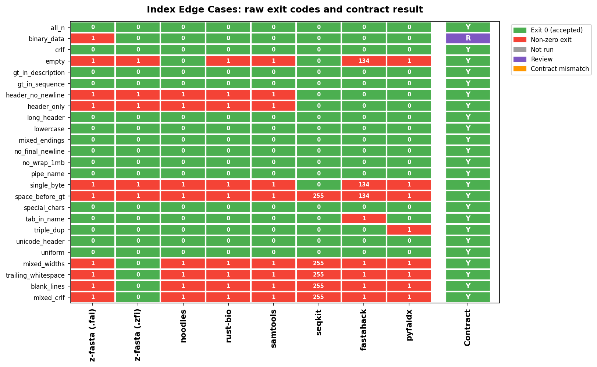
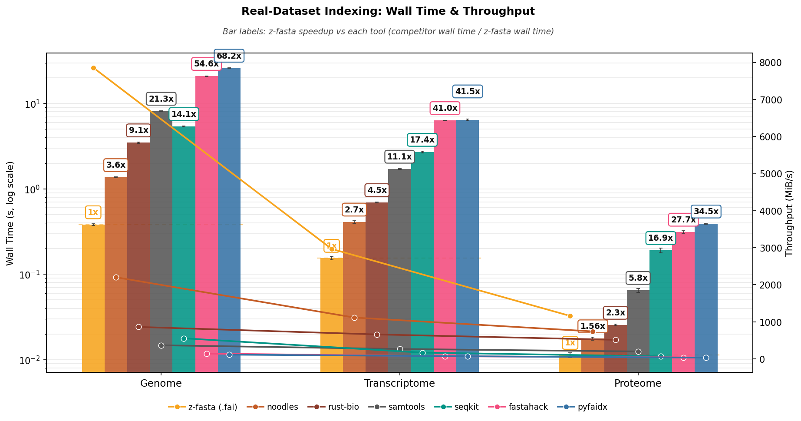
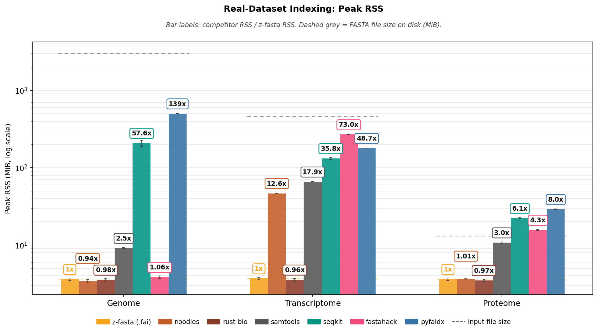
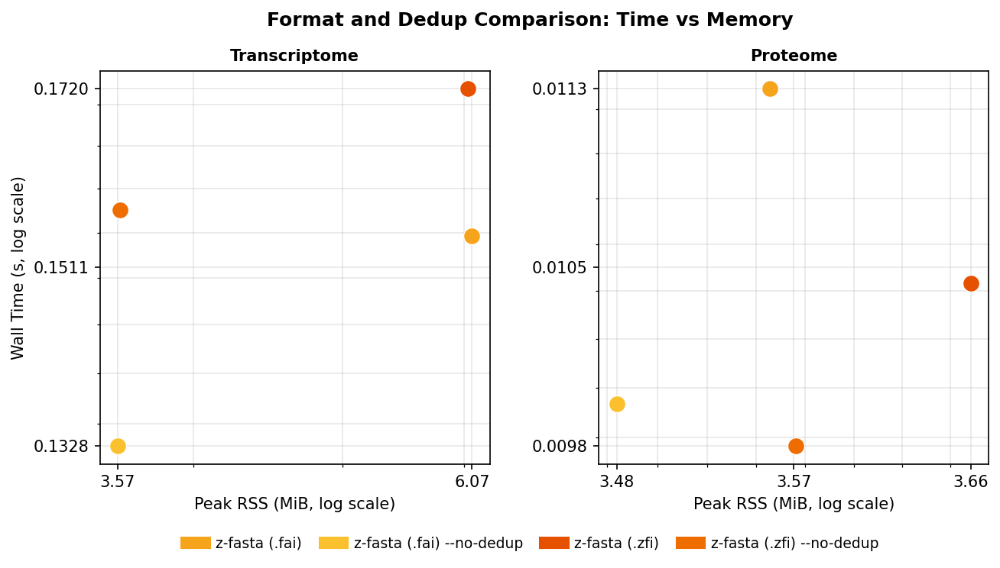
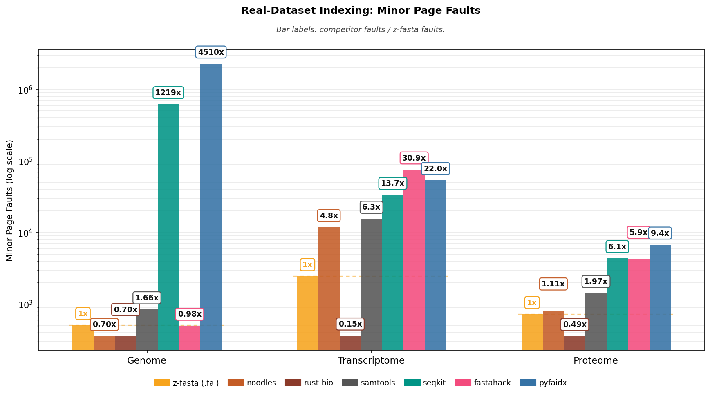
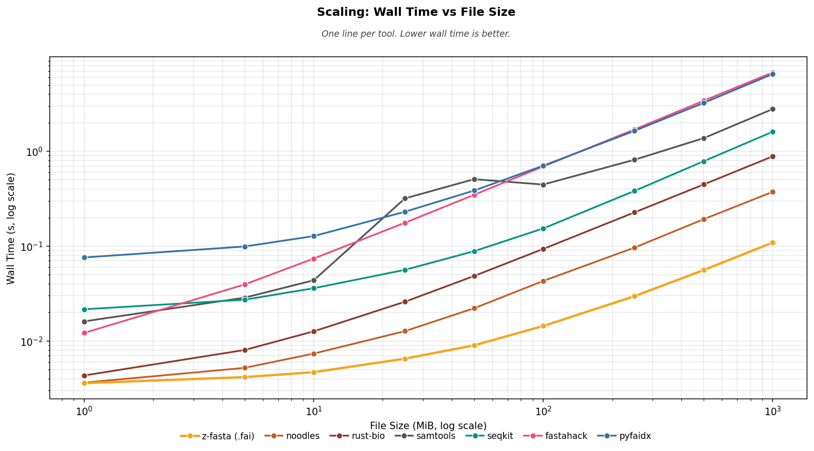
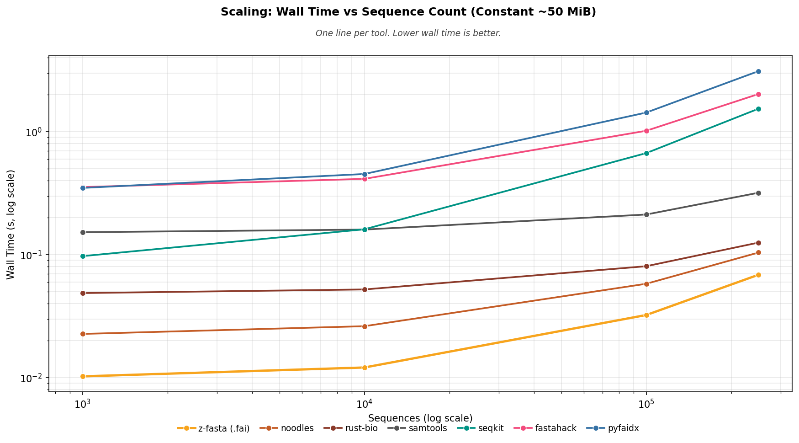
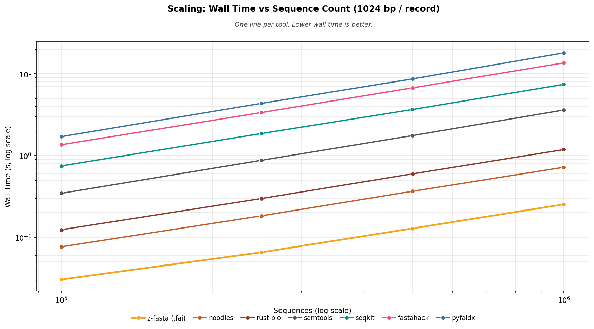

<!-- markdownlint-disable MD024 MD032 MD033 MD036 MD041 MD049 -->

# z-fasta Index Benchmark Report

_Auto-generated by `generate_report.py` from zebrac results._

## Overview

This report presents the benchmark sections captured by the selected run: correctness, real-data performance and memory, the two output formats, and synthetic scaling where available.

Cross-tool tables use `z-fasta index --emit-fai` because the peer tools write samtools-compatible `.fai` indexes. The z-fasta-only comparison separately covers `.fai` and the default `.zfi` on Transcriptome and Proteome.

The **rust-bio** label needs one clarification: rust-bio has no equivalent standalone FAI index command, so this benchmark lane uses the strict custom Rust FAI writer in the rust-bio wrapper. The label stays short in tables and figures, but the measured indexing code is custom.

Correctness covers strict FAI compatibility and z-fasta's `.zfi` support for ragged wrapping, trailing spaces, blank lines, and mixed line endings.

## Run Provenance

- **Build:** z-fasta v0.4.0; Zig 0.16.0; ReleaseFast; `x86_64-linux`.
- **Benchmark:** zebrac v0.6.2; warm cache; 5 measured samples after 3 warmups; 5000 ms budget per command.
**Source and executable facts**

```json
{
  "checkout_revision": "faf505d1a3f3404e18a2d4ad8744720af93ae71d",
  "checkout_dirty": true,
  "executable": {
    "path": "zig-out/bin/z-fasta",
    "size": 924808,
    "mtime_ns": 1792091667689566327,
    "ctime_ns": 1792091667745838707,
    "device": 52,
    "inode": 47976209
  },
  "declared_build": {
    "revision": null,
    "zig_version": "0.16.0",
    "optimize": "ReleaseFast",
    "target": "x86_64-linux.5.10...6.19-gnu.2.43"
  }
}
```

## Datasets

- **Genome:** Homo sapiens GRCh38 primary assembly (Ensembl release 113).
- **Transcriptome:** Homo sapiens GENCODE v46 transcript sequences.
- **Proteome:** Homo sapiens UniProt reference proteome UP000005640.

## Tools Tested

- **z-fasta (v0.4.0)**
  - `.fai`: peer-comparable cross-tool and scaling lane.
  - `.zfi`: default product mode.
- **noodles (v0.66.0)**: Rust noodles-fasta wrapper.
- **rust-bio (v4.0.1)**: Rust FASTA library.
- **samtools (v1.24)**: reference FAI indexer.
- **seqkit (v2.13.0)**: Go FASTA toolkit.
- **fastahack (v1.0.0)**: C++ FAI indexer.
- **pyfaidx (v0.9.0.4)**: Python FAI indexer.

## Edge Case Correctness

Each heatmap row is one structural FASTA edge case. The z-fasta columns separate the samtools-compatible FAI attempt from the production `.zfi` index. The **Contract** column marks whether z-fasta met that test's rules.

**Contract meaning:** for structural cases, `z-fasta (.fai)` must agree with samtools on FAI acceptance and bytes when both accept. If one accepts and the other rejects, the contract is `N`. For the four named messy fixtures, the `.zfi` side-table path is the contract because samtools cannot represent those layouts; the FAI rejection pair plus valid `.zfi` side table is `Y`.

**Scoring rules:**

- *Samtools parity* cases: when both z-fasta and samtools accept a file, their `.fai` output must match. When both reject it, that also counts as a match. A production `.zfi` success does not hide an FAI exit-code mismatch.

- *z-fasta-only* messy cases: z-fasta must index files where samtools rejects non-uniform wrapping (side-table `.zfi`).

**Table 1:** Comparability summary by contract class. Raw exit codes are diagnostic; `Result` applies the class-specific comparison rule.

| Contract basis       |   Cases | Result     | Comparison                                                    |
|:---------------------|--------:|:-----------|:--------------------------------------------------------------|
| FAI parity           |      19 | 19/19 pass | z-fasta (.fai) vs samtools acceptance and FAI bytes           |
| ZFI messy support    |       4 | 4/4 pass   | z-fasta (.zfi) side table; FAI peers expected incompatible    |
| Invalid input review |       1 | 1/1 review | raw behavior shown; no parity claim for binary input          |
| Every record indexed |       1 | 1/1 pass   | z-fasta (.fai) keeps each duplicate; samtools keeps the first |

<div style="margin: 1.5em 0"></div>

**Figure 1:** Raw per-test exit codes and the composite contract result. Green = exit 0; red = non-zero exit; gray = tool not run; purple = review; orange = contract mismatch.



**Reading Figure 1**
- Rows: structural FASTA edge cases.
- Tool columns show the numeric exit code; `n/a` means the optional tool was not run.
- **Contract:** `Y` = match, `R` = review, `N` = mismatch.
- Cell colors match the legend on the chart.
- Aggregate counts are in Table 1.

## Messy FASTA Compatibility

Proteome-derived messy FASTA fixtures. Each cell is zebrac with `--allow-failures` (repeated samples, not a single exit check).

**z-fasta lane:** This table must use `z-fasta (.zfi)` via default `index`. The `.fai` lane is not the messy compatibility claim; variable widths, trailing whitespace, and mixed line endings require the production `.zfi` side table.

**What z-fasta handles:** irregular line wrapping, trailing whitespace on sequence lines, blank lines between records, and mixed CRLF/LF. Those are common export glitches, not arbitrary byte corruption. z-fasta records true sequence boundaries in a side-table `.zfi` instead of assuming every line in a record has the same width.

**What we still reject:** empty files, headers without sequence, malformed headers, and other cases where indexing would be meaningless (see **Edge Case Correctness** above). We do not claim to repair truncated or binary-corrupted FASTA.

`mixed_crlf` deliberately alternates LF and CRLF sequence-line endings. It is not a uniformly CRLF-wrapped control file.

**Table 2:** Measured process result per variant and tool from the messy benchmark data. The z-fasta `.zfi` lane is `ok` only when every sample exits 0. Peer cells report only whether every measured sample exited 0; they do not claim sequence-retrieval compatibility.

| Variant             | z-fasta (.zfi)   | noodles   | rust-bio   | samtools   | seqkit   | fastahack   | pyfaidx   |
|:--------------------|:-----------------|:----------|:-----------|:-----------|:---------|:------------|:----------|
| all_messy           | ok               | nonzero   | nonzero    | nonzero    | nonzero  | nonzero     | nonzero   |
| mixed_crlf          | ok               | nonzero   | exit 0     | nonzero    | nonzero  | nonzero     | nonzero   |
| mixed_widths        | ok               | nonzero   | nonzero    | nonzero    | nonzero  | nonzero     | nonzero   |
| trailing_whitespace | ok               | nonzero   | nonzero    | nonzero    | nonzero  | nonzero     | nonzero   |

**Reading Table 2**
- Rows: messy variant names (`all_messy`, `mixed_crlf`, `mixed_widths`, `trailing_whitespace`).
- Columns: production `z-fasta (.zfi)` followed by FAI peers.
- `exit 0` and `nonzero` are measured process results, not output validation.

## Performance: Real Datasets

Headline comparison on the three human reference datasets (see **Datasets**). **z-fasta (.fai)** is `index --emit-fai`. It constructs the peer-compatible output while discarding the emitted stream; peers write sidecar files, so output destinations are not identical. CLI default `index` writes `.zfi`; see **z-fasta Format Comparison**.

**Measured result:** z-fasta is faster than every reported peer on Genome, Transcriptome, and Proteome. The narrowest lead is 1.98x against noodles on Proteome.

**Table 3:** Zebrac wall time per dataset (seconds, mean ± stddev, warm cache). Lower is better. Tool order: z-fasta, noodles, rust-bio, samtools, seqkit, fastahack, pyfaidx.

| dataset       | z-fasta (.fai)   | noodles         | rust-bio        | samtools        | seqkit          | fastahack        | pyfaidx          |
|:--------------|:-----------------|:----------------|:----------------|:----------------|:----------------|:-----------------|:-----------------|
| Genome        | 0.3279s ±0.0145  | 1.3459s ±0.0179 | 3.4821s ±0.0239 | 8.1025s ±0.0153 | 5.3928s ±0.0837 | 21.4902s ±0.2012 | 26.2267s ±0.3521 |
| Transcriptome | 0.1252s ±0.0032  | 0.4097s ±0.0110 | 0.7088s ±0.0048 | 1.7222s ±0.0109 | 2.7361s ±0.0627 | 6.4260s ±0.1541  | 6.5143s ±0.1804  |
| Proteome      | 0.0091s ±0.0003  | 0.0181s ±0.0004 | 0.0253s ±0.0002 | 0.0655s ±0.0022 | 0.1828s ±0.0064 | 0.3218s ±0.0108  | 0.3973s ±0.0071  |

<details>

<summary><strong>Table 4:</strong> Input throughput (MiB/s), calculated from input size and wall time. Higher is better. Same tools and order as Table 3.</summary>

| dataset       | z-fasta (.fai)   | noodles      | rust-bio    | samtools    | seqkit      | fastahack   | pyfaidx     |
|:--------------|:-----------------|:-------------|:------------|:------------|:------------|:------------|:------------|
| Genome        | 9165.6 MiB/s     | 2233.0 MiB/s | 863.1 MiB/s | 370.9 MiB/s | 557.3 MiB/s | 139.9 MiB/s | 114.6 MiB/s |
| Transcriptome | 3664.1 MiB/s     | 1119.5 MiB/s | 647.2 MiB/s | 266.3 MiB/s | 167.6 MiB/s | 71.4 MiB/s  | 70.4 MiB/s  |
| Proteome      | 1434.7 MiB/s     | 723.8 MiB/s  | 518.2 MiB/s | 199.9 MiB/s | 71.6 MiB/s  | 40.7 MiB/s  | 33.0 MiB/s  |

</details>

<details>

<summary><strong>Table 5:</strong> z-fasta vs each competitor. Speedup = competitor wall time / z-fasta wall time (higher = z-fasta faster). Same ratios appear as bar labels on Figure 2. Throughput ratio uses MiB/s.</summary>

| Dataset       | z-fasta vs   | z-fasta   | Competitor   | Speedup   |   z-fasta MiB/s |   Competitor MiB/s | Throughput ratio   |
|:--------------|:-------------|:----------|:-------------|:----------|----------------:|-------------------:|:-------------------|
| Genome        | noodles      | 0.3279s   | 1.3459s      | 4.1x      |          9165.6 |             2233   | 4.1x               |
| Genome        | rust-bio     | 0.3279s   | 3.4821s      | 10.6x     |          9165.6 |              863.1 | 10.6x              |
| Genome        | samtools     | 0.3279s   | 8.1025s      | 24.7x     |          9165.6 |              370.9 | 24.7x              |
| Genome        | seqkit       | 0.3279s   | 5.3928s      | 16.4x     |          9165.6 |              557.3 | 16.4x              |
| Genome        | fastahack    | 0.3279s   | 21.4902s     | 65.5x     |          9165.6 |              139.9 | 65.5x              |
| Genome        | pyfaidx      | 0.3279s   | 26.2267s     | 80.0x     |          9165.6 |              114.6 | 80.0x              |
| Transcriptome | noodles      | 0.1252s   | 0.4097s      | 3.3x      |          3664.1 |             1119.5 | 3.3x               |
| Transcriptome | rust-bio     | 0.1252s   | 0.7088s      | 5.7x      |          3664.1 |              647.2 | 5.7x               |
| Transcriptome | samtools     | 0.1252s   | 1.7222s      | 13.8x     |          3664.1 |              266.3 | 13.8x              |
| Transcriptome | seqkit       | 0.1252s   | 2.7361s      | 21.9x     |          3664.1 |              167.6 | 21.9x              |
| Transcriptome | fastahack    | 0.1252s   | 6.4260s      | 51.3x     |          3664.1 |               71.4 | 51.3x              |
| Transcriptome | pyfaidx      | 0.1252s   | 6.5143s      | 52.0x     |          3664.1 |               70.4 | 52.0x              |
| Proteome      | noodles      | 0.0091s   | 0.0181s      | 1.98x     |          1434.7 |              723.8 | 1.98x              |
| Proteome      | rust-bio     | 0.0091s   | 0.0253s      | 2.8x      |          1434.7 |              518.2 | 2.8x               |
| Proteome      | samtools     | 0.0091s   | 0.0655s      | 7.2x      |          1434.7 |              199.9 | 7.2x               |
| Proteome      | seqkit       | 0.0091s   | 0.1828s      | 20.0x     |          1434.7 |               71.6 | 20.0x              |
| Proteome      | fastahack    | 0.0091s   | 0.3218s      | 35.3x     |          1434.7 |               40.7 | 35.3x              |
| Proteome      | pyfaidx      | 0.0091s   | 0.3973s      | 43.5x     |          1434.7 |               33   | 43.5x              |

</details>

<div style="margin: 1.5em 0"></div>

**Figure 2:** Dual-axis chart for Table 3 and Table 4. Bars show wall time (left axis, log scale). Lines and markers show throughput (right axis). Legend colors: gold = z-fasta; bronze = noodles; red-brown = rust-bio; grey = samtools; teal = seqkit; pink = fastahack; blue = pyfaidx. Bar labels show z-fasta speedup vs each tool (see Table 5); gold dashed line = z-fasta wall time per dataset.



**Reading Figure 2**
- **Bars (left):** zebrac mean wall time. Error bars are one standard deviation.
- **Lines and markers (right):** input MiB/s for the same tool at each dataset.
- **Legend order:** z-fasta, noodles, rust-bio, samtools, seqkit, fastahack, pyfaidx.
- **Bar labels:** `1x` on z-fasta (baseline); competitor labels = z-fasta speedup (competitor time / z-fasta time). Border color matches the tool. Dashed gold line = z-fasta wall time for that dataset. Details in Table 5.
- **z-fasta only:** this section uses the peer-comparable `.fai` lane; format tradeoffs are in **z-fasta Format Comparison**.

## Memory Usage: Real Datasets

Same zebrac runs as **Performance: Real Datasets**. z-fasta (.fai) only; the `.zfi` lane is in **z-fasta Format Comparison**.

**Measured result:** noodles uses less peak RSS on Genome (3.41 MiB vs 3.61 MiB).

### Peak RSS

zebrac starts a new process for each sample and records peak RSS when it exits. That is the most RAM the process had in use at once (Linux `ru_maxrss` via `getrusage`). Table and figure show the mean across samples.

Use this to compare tools on the same file and host. Grey dashed lines show file size as context; the output format can still affect memory. A low bar does not always mean less work, so wall time and page faults provide the surrounding context.

**Table 6:** Peak RSS (MiB, zebrac mean). Same tool order as Performance.

| dataset       | z-fasta (.fai)   | noodles   | rust-bio   | samtools   | seqkit     | fastahack   | pyfaidx    |
|:--------------|:-----------------|:----------|:-----------|:-----------|:-----------|:------------|:-----------|
| Genome        | 3.61 MiB         | 3.41 MiB  | 3.54 MiB   | 9.11 MiB   | 208.06 MiB | 3.84 MiB    | 501.62 MiB |
| Transcriptome | 3.69 MiB         | 46.63 MiB | 3.55 MiB   | 65.82 MiB  | 132.10 MiB | 269.24 MiB  | 179.56 MiB |
| Proteome      | 3.62 MiB         | 3.66 MiB  | 3.49 MiB   | 10.76 MiB  | 22.13 MiB  | 15.63 MiB   | 29.02 MiB  |

<details>

<summary><strong>Table 7:</strong> z-fasta vs each competitor. RSS ratio = competitor peak RSS / z-fasta peak RSS. Same ratios as bar labels on Figure 3.</summary>

| Dataset       | z-fasta vs   | z-fasta   | Competitor   | RSS ratio   |
|:--------------|:-------------|:----------|:-------------|:------------|
| Genome        | noodles      | 3.61 MiB  | 3.41 MiB     | 0.94x       |
| Genome        | rust-bio     | 3.61 MiB  | 3.54 MiB     | 0.98x       |
| Genome        | samtools     | 3.61 MiB  | 9.11 MiB     | 2.5x        |
| Genome        | seqkit       | 3.61 MiB  | 208.06 MiB   | 57.6x       |
| Genome        | fastahack    | 3.61 MiB  | 3.84 MiB     | 1.06x       |
| Genome        | pyfaidx      | 3.61 MiB  | 501.62 MiB   | 139x        |
| Transcriptome | noodles      | 3.69 MiB  | 46.63 MiB    | 12.6x       |
| Transcriptome | rust-bio     | 3.69 MiB  | 3.55 MiB     | 0.96x       |
| Transcriptome | samtools     | 3.69 MiB  | 65.82 MiB    | 17.9x       |
| Transcriptome | seqkit       | 3.69 MiB  | 132.10 MiB   | 35.8x       |
| Transcriptome | fastahack    | 3.69 MiB  | 269.24 MiB   | 73.0x       |
| Transcriptome | pyfaidx      | 3.69 MiB  | 179.56 MiB   | 48.7x       |
| Proteome      | noodles      | 3.62 MiB  | 3.66 MiB     | 1.01x       |
| Proteome      | rust-bio     | 3.62 MiB  | 3.49 MiB     | 0.97x       |
| Proteome      | samtools     | 3.62 MiB  | 10.76 MiB    | 3.0x        |
| Proteome      | seqkit       | 3.62 MiB  | 22.13 MiB    | 6.1x        |
| Proteome      | fastahack    | 3.62 MiB  | 15.63 MiB    | 4.3x        |
| Proteome      | pyfaidx      | 3.62 MiB  | 29.02 MiB    | 8.0x        |

</details>

<div style="margin: 1.5em 0"></div>

**Figure 3:** Table 6 as grouped bars (log scale). Bar labels = RSS ratio (see Table 7). Gold dashed line = z-fasta RSS; grey dashed = FASTA file size on disk.



**Reading Figure 3**
- Bars: mean peak RSS. `1x` on z-fasta; other labels = competitor / z-fasta.
- Gold dashed line: z-fasta RSS for that dataset.
- Grey dashed line: input FASTA size.
- Details in Table 7.

## z-fasta Format Comparison

This focused z-fasta comparison uses **Transcriptome** and **Proteome**. It isolates the output format: `.fai` from `index --emit-fai`, and the default `.zfi`. Peer indexers stay in the cross-tool performance sections, where they answer a different question.

**Table 8:** Measured wall time and peak RSS for each format. Each ratio is `.zfi` divided by `.fai` within the same dataset.

| Dataset       | .fai wall       | .zfi wall       | Wall ratio   | .fai RSS   | .zfi RSS   | RSS ratio   |
|:--------------|:----------------|:----------------|:-------------|:-----------|:-----------|:------------|
| Transcriptome | 0.1252s ±0.0032 | 0.1472s ±0.0056 | 1.18x        | 3.69 MiB   | 3.65 MiB   | 0.99x       |
| Proteome      | 0.0091s ±0.0003 | 0.0102s ±0.0004 | 1.12x        | 3.62 MiB   | 3.58 MiB   | 0.99x       |

<div style="margin: 1.5em 0"></div>

**Figure 4:** The same measured configurations plotted by peak RSS and wall time. Both axes use log scale; lower-left is faster with less process memory.



**Reading Figure 4**
- Panels: Transcriptome and Proteome.
- Gold points: `.fai`; orange points: `.zfi`.
- Exact measurements and ratios are in Table 8.

## Page Faults: Real Datasets

Same zebrac samples as the real-dataset performance and memory sections.

### Page faults

A **minor** fault maps a page without reading disk. A **major** fault reads from disk. zebrac reports both per run, like wall time. Table 11 lists major faults separately.

**Table 9:** Minor page faults (zebrac mean). Same tool order as Performance.

| dataset       |   z-fasta (.fai) |   noodles |   rust-bio |   samtools |   seqkit |   fastahack |   pyfaidx |
|:--------------|-----------------:|----------:|-----------:|-----------:|---------:|------------:|----------:|
| Genome        |              442 |       360 |        356 |        846 |  635,286 |         502 | 2,292,140 |
| Transcriptome |              500 |    11,867 |        362 |     15,579 |   33,288 |      75,990 |    54,106 |
| Proteome      |              500 |       810 |        358 |      1,430 |    4,521 |       4,249 |     6,786 |

<details>

<summary><strong>Table 10:</strong> z-fasta vs each competitor. Faults ratio = competitor minor faults / z-fasta minor faults. Same ratios as bar labels on Figure 5.</summary>

| Dataset       | z-fasta vs   |   z-fasta |   Competitor | Faults ratio   |
|:--------------|:-------------|----------:|-------------:|:---------------|
| Genome        | noodles      |       442 |          360 | 0.81x          |
| Genome        | rust-bio     |       442 |          356 | 0.81x          |
| Genome        | samtools     |       442 |          846 | 1.91x          |
| Genome        | seqkit       |       442 |      635,286 | 1436x          |
| Genome        | fastahack    |       442 |          502 | 1.14x          |
| Genome        | pyfaidx      |       442 |    2,292,140 | 5181x          |
| Transcriptome | noodles      |       500 |       11,867 | 23.7x          |
| Transcriptome | rust-bio     |       500 |          362 | 0.72x          |
| Transcriptome | samtools     |       500 |       15,579 | 31.1x          |
| Transcriptome | seqkit       |       500 |       33,288 | 66.5x          |
| Transcriptome | fastahack    |       500 |       75,990 | 152x           |
| Transcriptome | pyfaidx      |       500 |       54,106 | 108x           |
| Proteome      | noodles      |       500 |          810 | 1.62x          |
| Proteome      | rust-bio     |       500 |          358 | 0.72x          |
| Proteome      | samtools     |       500 |        1,430 | 2.9x           |
| Proteome      | seqkit       |       500 |        4,521 | 9.0x           |
| Proteome      | fastahack    |       500 |        4,249 | 8.5x           |
| Proteome      | pyfaidx      |       500 |        6,786 | 13.6x          |

</details>

<details>

<summary><strong>Table 11:</strong> Major page faults.</summary>

| dataset       |   z-fasta (.fai) |   noodles |   rust-bio |   samtools |   seqkit |   fastahack |   pyfaidx |
|:--------------|-----------------:|----------:|-----------:|-----------:|---------:|------------:|----------:|
| Genome        |                0 |         0 |          0 |          0 |        0 |           0 |         0 |
| Transcriptome |                0 |         0 |          0 |          0 |        0 |           0 |         0 |
| Proteome      |                0 |         0 |          0 |          0 |        0 |           0 |         0 |

</details>

<div style="margin: 1.5em 0"></div>

**Figure 5:** Table 9 as grouped bars (log scale). Bar labels = Faults ratio (see Table 10). Gold dashed line = z-fasta minor faults.



**Reading Figure 5**
- Bars: mean minor faults. `1x` on z-fasta; other labels = competitor / z-fasta.
- Gold dashed line: z-fasta count for that dataset.
- Lower bar = fewer minor faults.
- Details in Table 10.

## Scaling: File Size

Synthetic FASTA files from 1 MiB to 1000 MiB with 100 sequences per file. Uses the zebrac warm-cache setup in **Run Provenance** and the peer-comparable z-fasta `.fai` lane.

**Measured result:** z-fasta is fastest at every measured point.

### Wall time vs file size

Mean wall time (seconds, zebrac) at each file size. **Lower is better.** Record count stays fixed at 100 while total bytes on disk grow.

<details>

<summary><strong>Table 12:</strong> Wall time per file size (zebrac mean, seconds). Tool order: z-fasta, noodles, rust-bio, samtools, seqkit, fastahack, pyfaidx.</summary>

| File Size   |   z-fasta (.fai) |   noodles |   rust-bio |   samtools |   seqkit |   fastahack |   pyfaidx |
|:------------|-----------------:|----------:|-----------:|-----------:|---------:|------------:|----------:|
| 1 MiB       |           0.0036 |    0.0036 |     0.0043 |     0.0161 |   0.0216 |      0.0122 |    0.0760 |
| 5 MiB       |           0.0042 |    0.0052 |     0.0080 |     0.0286 |   0.0272 |      0.0394 |    0.0991 |
| 10 MiB      |           0.0047 |    0.0074 |     0.0126 |     0.0436 |   0.0360 |      0.0740 |    0.1276 |
| 25 MiB      |           0.0065 |    0.0127 |     0.0259 |     0.3189 |   0.0563 |      0.1765 |    0.2305 |
| 50 MiB      |           0.0090 |    0.0221 |     0.0485 |     0.5081 |   0.0884 |      0.3478 |    0.3854 |
| 100 MiB     |           0.0144 |    0.0429 |     0.0934 |     0.4461 |   0.1536 |      0.6909 |    0.7047 |
| 250 MiB     |           0.0297 |    0.0966 |     0.2271 |     0.8145 |   0.3822 |      1.7009 |    1.6434 |
| 500 MiB     |           0.0560 |    0.1922 |     0.4466 |     1.3759 |   0.7848 |      3.4118 |    3.2365 |
| 1000 MiB    |           0.1090 |    0.3739 |     0.8850 |     2.7888 |   1.6087 |      6.7849 |    6.5257 |

</details>

<details>

<summary><strong>Table 13:</strong> z-fasta vs each competitor at each file size. Time ratio = competitor wall time / z-fasta wall time.</summary>

| File Size   | z-fasta vs   | z-fasta   | Competitor   | Time ratio   |
|:------------|:-------------|:----------|:-------------|:-------------|
| 1 MiB       | noodles      | 0.0036s   | 0.0036s      | 1.01x        |
| 1 MiB       | rust-bio     | 0.0036s   | 0.0043s      | 1.21x        |
| 1 MiB       | samtools     | 0.0036s   | 0.0161s      | 4.5x         |
| 1 MiB       | seqkit       | 0.0036s   | 0.0216s      | 6.0x         |
| 1 MiB       | fastahack    | 0.0036s   | 0.0122s      | 3.4x         |
| 1 MiB       | pyfaidx      | 0.0036s   | 0.0760s      | 21.2x        |
| 5 MiB       | noodles      | 0.0042s   | 0.0052s      | 1.25x        |
| 5 MiB       | rust-bio     | 0.0042s   | 0.0080s      | 1.93x        |
| 5 MiB       | samtools     | 0.0042s   | 0.0286s      | 6.9x         |
| 5 MiB       | seqkit       | 0.0042s   | 0.0272s      | 6.5x         |
| 5 MiB       | fastahack    | 0.0042s   | 0.0394s      | 9.5x         |
| 5 MiB       | pyfaidx      | 0.0042s   | 0.0991s      | 23.8x        |
| 10 MiB      | noodles      | 0.0047s   | 0.0074s      | 1.57x        |
| 10 MiB      | rust-bio     | 0.0047s   | 0.0126s      | 2.7x         |
| 10 MiB      | samtools     | 0.0047s   | 0.0436s      | 9.3x         |
| 10 MiB      | seqkit       | 0.0047s   | 0.0360s      | 7.7x         |
| 10 MiB      | fastahack    | 0.0047s   | 0.0740s      | 15.8x        |
| 10 MiB      | pyfaidx      | 0.0047s   | 0.1276s      | 27.2x        |
| 25 MiB      | noodles      | 0.0065s   | 0.0127s      | 1.95x        |
| 25 MiB      | rust-bio     | 0.0065s   | 0.0259s      | 4.0x         |
| 25 MiB      | samtools     | 0.0065s   | 0.3189s      | 49.0x        |
| 25 MiB      | seqkit       | 0.0065s   | 0.0563s      | 8.6x         |
| 25 MiB      | fastahack    | 0.0065s   | 0.1765s      | 27.1x        |
| 25 MiB      | pyfaidx      | 0.0065s   | 0.2305s      | 35.4x        |
| 50 MiB      | noodles      | 0.0090s   | 0.0221s      | 2.5x         |
| 50 MiB      | rust-bio     | 0.0090s   | 0.0485s      | 5.4x         |
| 50 MiB      | samtools     | 0.0090s   | 0.5081s      | 56.4x        |
| 50 MiB      | seqkit       | 0.0090s   | 0.0884s      | 9.8x         |
| 50 MiB      | fastahack    | 0.0090s   | 0.3478s      | 38.6x        |
| 50 MiB      | pyfaidx      | 0.0090s   | 0.3854s      | 42.8x        |
| 100 MiB     | noodles      | 0.0144s   | 0.0429s      | 3.0x         |
| 100 MiB     | rust-bio     | 0.0144s   | 0.0934s      | 6.5x         |
| 100 MiB     | samtools     | 0.0144s   | 0.4461s      | 31.0x        |
| 100 MiB     | seqkit       | 0.0144s   | 0.1536s      | 10.7x        |
| 100 MiB     | fastahack    | 0.0144s   | 0.6909s      | 48.0x        |
| 100 MiB     | pyfaidx      | 0.0144s   | 0.7047s      | 49.0x        |
| 250 MiB     | noodles      | 0.0297s   | 0.0966s      | 3.3x         |
| 250 MiB     | rust-bio     | 0.0297s   | 0.2271s      | 7.7x         |
| 250 MiB     | samtools     | 0.0297s   | 0.8145s      | 27.5x        |
| 250 MiB     | seqkit       | 0.0297s   | 0.3822s      | 12.9x        |
| 250 MiB     | fastahack    | 0.0297s   | 1.7009s      | 57.3x        |
| 250 MiB     | pyfaidx      | 0.0297s   | 1.6434s      | 55.4x        |
| 500 MiB     | noodles      | 0.0560s   | 0.1922s      | 3.4x         |
| 500 MiB     | rust-bio     | 0.0560s   | 0.4466s      | 8.0x         |
| 500 MiB     | samtools     | 0.0560s   | 1.3759s      | 24.6x        |
| 500 MiB     | seqkit       | 0.0560s   | 0.7848s      | 14.0x        |
| 500 MiB     | fastahack    | 0.0560s   | 3.4118s      | 60.9x        |
| 500 MiB     | pyfaidx      | 0.0560s   | 3.2365s      | 57.8x        |
| 1000 MiB    | noodles      | 0.1090s   | 0.3739s      | 3.4x         |
| 1000 MiB    | rust-bio     | 0.1090s   | 0.8850s      | 8.1x         |
| 1000 MiB    | samtools     | 0.1090s   | 2.7888s      | 25.6x        |
| 1000 MiB    | seqkit       | 0.1090s   | 1.6087s      | 14.8x        |
| 1000 MiB    | fastahack    | 0.1090s   | 6.7849s      | 62.2x        |
| 1000 MiB    | pyfaidx      | 0.1090s   | 6.5257s      | 59.9x        |

</details>

<details>

<summary><strong>Table 14:</strong> z-fasta peak RSS across the same file size sweep.</summary>

| File Size   |   Peak RSS (MiB) |   RSS spread (MiB) |
|:------------|-----------------:|-------------------:|
| 1 MiB       |             3.63 |               0.3  |
| 5 MiB       |             3.5  |               0.21 |
| 10 MiB      |             3.47 |               0.26 |
| 25 MiB      |             3.61 |               0.29 |
| 50 MiB      |             3.56 |               0.27 |
| 100 MiB     |             3.58 |               0.26 |
| 250 MiB     |             3.53 |               0.25 |
| 500 MiB     |             3.55 |               0.17 |
| 1000 MiB    |             3.65 |               0.53 |

</details>

<div style="margin: 1.5em 0"></div>

**Figure 6:** Table 12 as lines (log scales on both axes). One line per tool; absolute wall times only.



**Reading Figure 6**
- Lines: mean wall time vs file size (MiB). Both axes use log scale.
- Lower on the chart = faster at that file size.
- Legend order: z-fasta, noodles, rust-bio, samtools, seqkit, fastahack, pyfaidx.
- Time ratios are in Table 13; the chart does not show them.

## Scaling: Sequence Count (Constant File Size)

Synthetic FASTA holding about **50 MiB** total per file; sequence length shrinks as record count rises. Uses the zebrac warm-cache setup in **Run Provenance** and the peer-comparable z-fasta `.fai` lane.

**Measured result:** z-fasta is fastest at every measured point.

### Wall time vs sequence count (constant file size)

Mean wall time (seconds, zebrac) at each record count. **Lower is better.** Isolates per-record and header overhead at near-constant file size.

<details>

<summary><strong>Table 15:</strong> Wall time per record count (zebrac mean, seconds). Tool order: z-fasta, noodles, rust-bio, samtools, seqkit, fastahack, pyfaidx.</summary>

|   Sequences |   z-fasta (.fai) |   noodles |   rust-bio |   samtools |   seqkit |   fastahack |   pyfaidx |
|------------:|-----------------:|----------:|-----------:|-----------:|---------:|------------:|----------:|
|       1,000 |           0.0094 |    0.0225 |     0.0489 |     0.1522 |   0.0953 |      0.3936 |    0.3490 |
|      10,000 |           0.0104 |    0.0255 |     0.0513 |     0.1583 |   0.1592 |      0.4114 |    0.4391 |
|     100,000 |           0.0240 |    0.0577 |     0.0808 |     0.2113 |   0.6475 |      1.0473 |    1.4864 |
|     250,000 |           0.0479 |    0.1053 |     0.1239 |     0.3170 |   1.5310 |      2.0174 |    3.1672 |

</details>

<details>

<summary><strong>Table 16:</strong> z-fasta vs each competitor at each record count. Time ratio = competitor wall time / z-fasta wall time.</summary>

|   Sequences | z-fasta vs   | z-fasta   | Competitor   | Time ratio   |
|------------:|:-------------|:----------|:-------------|:-------------|
|       1,000 | noodles      | 0.0094s   | 0.0225s      | 2.4x         |
|       1,000 | rust-bio     | 0.0094s   | 0.0489s      | 5.2x         |
|       1,000 | samtools     | 0.0094s   | 0.1522s      | 16.2x        |
|       1,000 | seqkit       | 0.0094s   | 0.0953s      | 10.1x        |
|       1,000 | fastahack    | 0.0094s   | 0.3936s      | 41.9x        |
|       1,000 | pyfaidx      | 0.0094s   | 0.3490s      | 37.1x        |
|      10,000 | noodles      | 0.0104s   | 0.0255s      | 2.5x         |
|      10,000 | rust-bio     | 0.0104s   | 0.0513s      | 5.0x         |
|      10,000 | samtools     | 0.0104s   | 0.1583s      | 15.3x        |
|      10,000 | seqkit       | 0.0104s   | 0.1592s      | 15.4x        |
|      10,000 | fastahack    | 0.0104s   | 0.4114s      | 39.7x        |
|      10,000 | pyfaidx      | 0.0104s   | 0.4391s      | 42.4x        |
|     100,000 | noodles      | 0.0240s   | 0.0577s      | 2.4x         |
|     100,000 | rust-bio     | 0.0240s   | 0.0808s      | 3.4x         |
|     100,000 | samtools     | 0.0240s   | 0.2113s      | 8.8x         |
|     100,000 | seqkit       | 0.0240s   | 0.6475s      | 27.0x        |
|     100,000 | fastahack    | 0.0240s   | 1.0473s      | 43.6x        |
|     100,000 | pyfaidx      | 0.0240s   | 1.4864s      | 61.9x        |
|     250,000 | noodles      | 0.0479s   | 0.1053s      | 2.2x         |
|     250,000 | rust-bio     | 0.0479s   | 0.1239s      | 2.6x         |
|     250,000 | samtools     | 0.0479s   | 0.3170s      | 6.6x         |
|     250,000 | seqkit       | 0.0479s   | 1.5310s      | 31.9x        |
|     250,000 | fastahack    | 0.0479s   | 2.0174s      | 42.1x        |
|     250,000 | pyfaidx      | 0.0479s   | 3.1672s      | 66.1x        |

</details>

<details>

<summary><strong>Table 17:</strong> z-fasta peak RSS across the same record count sweep.</summary>

|   Sequences |   Peak RSS (MiB) |   RSS spread (MiB) |
|------------:|-----------------:|-------------------:|
|       1,000 |             3.57 |               0.44 |
|      10,000 |             3.53 |               0.24 |
|     100,000 |             3.58 |               0.3  |
|     250,000 |             3.65 |               0.54 |

</details>

<div style="margin: 1.5em 0"></div>

**Figure 7:** Table 15 as lines (log scales on both axes). One line per tool; absolute wall times only.



**Reading Figure 7**
- Lines: mean wall time vs sequence count. Both axes use log scale.
- Lower on the chart = faster at that record count.
- Legend order: z-fasta, noodles, rust-bio, samtools, seqkit, fastahack, pyfaidx.
- Time ratios are in Table 16; the chart does not show them.

## Scaling: Sequence Count (Fixed Length)

Synthetic FASTA with **1024 bp** per sequence; total file size grows with record count (100k to 1M). Uses the zebrac warm-cache setup in **Run Provenance** and the peer-comparable z-fasta `.fai` lane.

**Measured result:** z-fasta is fastest at every measured point.

### Wall time vs sequence count (fixed length)

Mean wall time (seconds, zebrac) at each record count. **Lower is better.** Bytes and index entries grow together; the 1M point is about 1 GiB on disk.

<details>

<summary><strong>Table 18:</strong> Wall time per record count (zebrac mean, seconds). Tool order: z-fasta, noodles, rust-bio, samtools, seqkit, fastahack, pyfaidx.</summary>

|   Sequences |   z-fasta (.fai) |   noodles |   rust-bio |   samtools |   seqkit |   fastahack |   pyfaidx |
|------------:|-----------------:|----------:|-----------:|-----------:|---------:|------------:|----------:|
|     100,000 |           0.0304 |    0.0766 |     0.1239 |     0.3454 |   0.7477 |      1.3586 |    1.7078 |
|     250,000 |           0.0655 |    0.1831 |     0.2981 |     0.8752 |   1.8614 |      3.3602 |    4.3490 |
|     500,000 |           0.1285 |    0.3660 |     0.5975 |     1.7579 |   3.6631 |      6.7369 |    8.6746 |
|   1,000,000 |           0.2534 |    0.7200 |     1.1851 |     3.6109 |   7.4293 |     13.6173 |   18.0628 |

</details>

<details>

<summary><strong>Table 19:</strong> z-fasta vs each competitor at each record count. Time ratio = competitor wall time / z-fasta wall time.</summary>

|   Sequences | z-fasta vs   | z-fasta   | Competitor   | Time ratio   |
|------------:|:-------------|:----------|:-------------|:-------------|
|     100,000 | noodles      | 0.0304s   | 0.0766s      | 2.5x         |
|     100,000 | rust-bio     | 0.0304s   | 0.1239s      | 4.1x         |
|     100,000 | samtools     | 0.0304s   | 0.3454s      | 11.3x        |
|     100,000 | seqkit       | 0.0304s   | 0.7477s      | 24.6x        |
|     100,000 | fastahack    | 0.0304s   | 1.3586s      | 44.6x        |
|     100,000 | pyfaidx      | 0.0304s   | 1.7078s      | 56.1x        |
|     250,000 | noodles      | 0.0655s   | 0.1831s      | 2.8x         |
|     250,000 | rust-bio     | 0.0655s   | 0.2981s      | 4.5x         |
|     250,000 | samtools     | 0.0655s   | 0.8752s      | 13.4x        |
|     250,000 | seqkit       | 0.0655s   | 1.8614s      | 28.4x        |
|     250,000 | fastahack    | 0.0655s   | 3.3602s      | 51.3x        |
|     250,000 | pyfaidx      | 0.0655s   | 4.3490s      | 66.4x        |
|     500,000 | noodles      | 0.1285s   | 0.3660s      | 2.8x         |
|     500,000 | rust-bio     | 0.1285s   | 0.5975s      | 4.7x         |
|     500,000 | samtools     | 0.1285s   | 1.7579s      | 13.7x        |
|     500,000 | seqkit       | 0.1285s   | 3.6631s      | 28.5x        |
|     500,000 | fastahack    | 0.1285s   | 6.7369s      | 52.4x        |
|     500,000 | pyfaidx      | 0.1285s   | 8.6746s      | 67.5x        |
|   1,000,000 | noodles      | 0.2534s   | 0.7200s      | 2.8x         |
|   1,000,000 | rust-bio     | 0.2534s   | 1.1851s      | 4.7x         |
|   1,000,000 | samtools     | 0.2534s   | 3.6109s      | 14.3x        |
|   1,000,000 | seqkit       | 0.2534s   | 7.4293s      | 29.3x        |
|   1,000,000 | fastahack    | 0.2534s   | 13.6173s     | 53.7x        |
|   1,000,000 | pyfaidx      | 0.2534s   | 18.0628s     | 71.3x        |

</details>

<details>

<summary><strong>Table 20:</strong> z-fasta peak RSS across the same record count sweep.</summary>

|   Sequences |   Peak RSS (MiB) |   RSS spread (MiB) |
|------------:|-----------------:|-------------------:|
|     100,000 |             3.54 |               0.28 |
|     250,000 |             3.59 |               0.19 |
|     500,000 |             3.56 |               0.27 |
|   1,000,000 |             3.55 |               0.31 |

</details>

<div style="margin: 1.5em 0"></div>

**Figure 8:** Table 18 as lines (log scales on both axes). One line per tool; absolute wall times only.



**Reading Figure 8**
- Lines: mean wall time vs sequence count. Both axes use log scale.
- Lower on the chart = faster at that record count.
- Legend order: z-fasta, noodles, rust-bio, samtools, seqkit, fastahack, pyfaidx.
- Time ratios are in Table 19; the chart does not show them.
