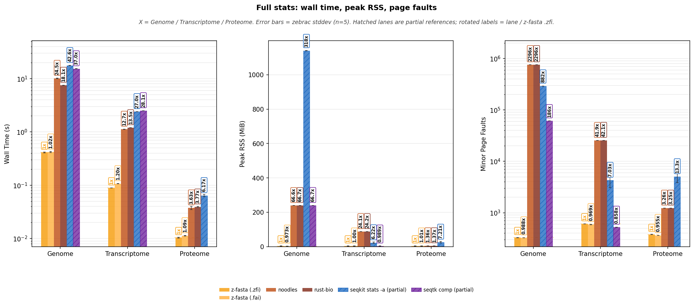
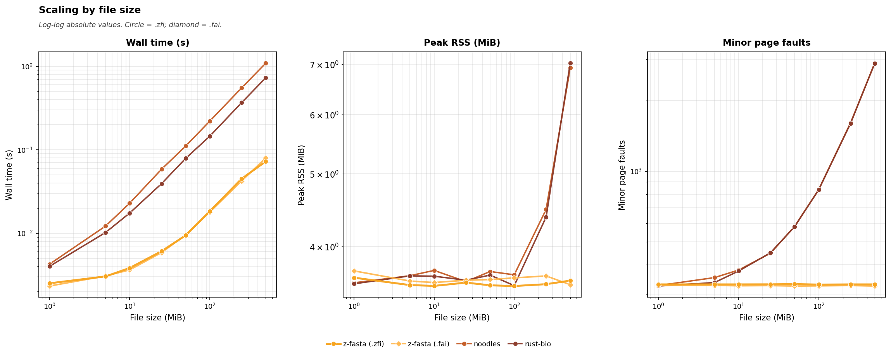
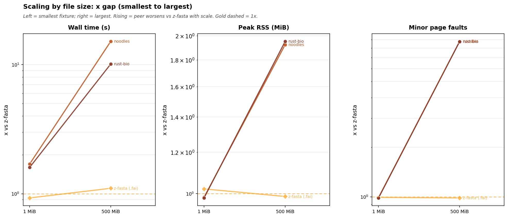
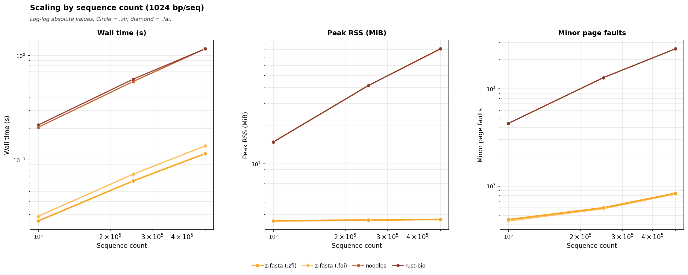
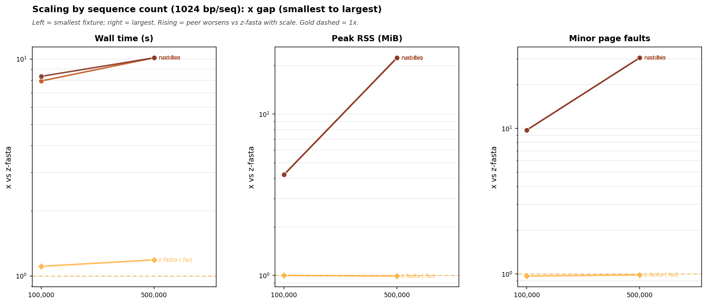

<!-- markdownlint-disable MD024 MD032 MD033 MD036 MD041 MD049 -->

# z-fasta Stats Benchmark Report

_Auto-generated by `bench/stats/generate_report.py` from zebrac results._

## Overview

This report times `z-fasta stats` against clean-FASTA peers on the shared REAL datasets (Genome, Transcriptome, Proteome) and on synthetic size / sequence-count sweeps.

**What is timed**

- **Complete stats:** `z-fasta stats` through `.zfi` and `.fai` vs noodles and rust-bio wrappers that emit the same agreed fields.
- **Partial references:** SeqKit `stats -a` covers assembly summaries and selected DNA composition; Seqtk `comp` covers per-record A/C/G/T/N composition on nucleotide data.
- **Scaling:** the two z-fasta formats plus the two complete Rust peers; partial references are intentionally excluded.

**Index policy:** sidecars are preloaded once. Timed commands only run `stats` / peer tools; index *build* is outside this wall (see `bench/index/REPORT.md`).

Correctness reported **66** passing checks before perf (see `bench/stats/run.sh`).

Correctness values are gated by the independent exact oracle in `bench/stats/oracle.py`, not re-tabulated here.

## What each tool reports

`z-fasta stats` reads length metadata from the selected sidecar, then scans sequence bytes for composition. Peers re-parse the FASTA every time.

### Assembly metrics (lengths / index)

| Metric | z-fasta | noodles | rust-bio | SeqKit `stats -a` | Seqtk `comp` |
| --- | --- | --- | --- | --- | --- |
| Records / total symbols | yes | yes | yes | yes | per-record lengths |
| Shortest / longest / mean / quartiles / median / range | yes | yes | yes | lengths except range | no |
| N50 / L50 / N90 / L90 / auN | yes | yes | yes | N50/L50 only | no |
| Shortest / longest names | yes | yes | yes | no | record names only |

### Composition (sequence scan)

| Metric | z-fasta | noodles | rust-bio | SeqKit `stats -a` | Seqtk `comp` |
| --- | --- | --- | --- | --- | --- |
| Nucleotide type / canonical bases / ambiguity / invalid | yes | yes | yes | type, N/gap totals | A/C/G/T/N plus other columns |
| GC / GC skew / lowercase | yes | yes | yes | GC only | GC derivable, no skew/lowercase |
| Complete protein symbols / stop / invalid / lowercase | yes | yes | yes | type only | no |

**How to read the benches:** Noodles and rust-bio are equivalent-work peers. SeqKit and Seqtk are useful ecosystem references but do less work and are never used for dominance claims. Wrappers are clean-FASTA peers only; messy side-table behavior is a z-fasta correctness gate.

Oracle: [`bench/stats/oracle.py`](oracle.py). Verify: [`bench/stats/run.sh`](run.sh) correctness (`run_tests`).

## Run Provenance

- **Timestamp:** `20261015_124934`
- **Runner:** zebrac (warm)
- **zebrac:** zebrac 0.6.2
- **z-fasta:** z-fasta 0.4.0
- **Samples:** runs=5, warmup=3, duration_ms=5000
- **Metadata:** `metadata_20261015_124934.jsonl`
- **Index preload:** True (build time not included in stats wall)

**Sections**

**Source and executable facts**

```json
{
  "checkout_revision": "faf505d1a3f3404e18a2d4ad8744720af93ae71d",
  "checkout_dirty": true,
  "executable": {
    "path": "zig-out/bin/z-fasta",
    "size": 924808,
    "mtime_ns": 1792091667689566327,
    "ctime_ns": 1792091667745838707,
    "device": 52,
    "inode": 47976209
  },
  "declared_build": {
    "revision": null,
    "zig_version": null,
    "optimize": null,
    "target": null
  }
}
```

- `perf_full` -> `perf_full_20261015_124934`
- `scale_size` -> `scale_size_20261015_124934`
- `scale_seqs_fixed` -> `scale_seqs_fixed_20261015_124934`

**Peer versions**

- **seqkit:** seqkit v2.13.0
- **seqtk:** seqtk 1.5-r133
- **noodles:** noodles-fasta 0.66.0 (wrapper)
- **rustbio:** rust-bio 4.0.1 (custom indexer wrapper)
- **samtools:** samtools 1.24

- **Genome:** Homo sapiens GRCh38 primary assembly (Ensembl release 113).
- **Transcriptome:** Homo sapiens GENCODE v46 transcript sequences.
- **Proteome:** Homo sapiens UniProt reference proteome UP000005640.

## Performance: Full stats

Peers re-parse the FASTA. z-fasta loads one selected sidecar and performs a bounded FASTA scan for composition. Baseline for ratios: **z-fasta (.zfi)**. **Figure facets** are wall time, peak RSS, and minor page faults; **x-axis** is dataset; **bar color** is tool (GET RC layout).

## Wall time

Zebrac mean wall time (seconds) for one `stats` / peer process with stdout discarded.

**Table 1:** Mean ± stddev by dataset and tool.

| dataset       | z-fasta (.zfi)   | z-fasta (.fai)   | noodles        | rust-bio      | seqkit stats -a (partial)   | seqtk comp (partial)   |
|:--------------|:-----------------|:-----------------|:---------------|:--------------|:----------------------------|:-----------------------|
| Genome        | 0.413±0.009 s    | 0.421±0.012 s    | 10.144±0.132 s | 7.490±0.054 s | 17.619±0.097 s              | 15.297±0.017 s         |
| Transcriptome | 0.089±0.000 s    | 0.107±0.001 s    | 1.125±0.007 s  | 1.200±0.005 s | 2.405±0.005 s               | 2.500±0.005 s          |
| Proteome      | 0.010±0.000 s    | 0.011±0.000 s    | 0.038±0.003 s  | 0.039±0.001 s | 0.064±0.003 s               |                     |

<details><summary><strong>Table 2:</strong> Time x = lane wall / z-fasta .zfi. Same ratios as bar labels.</summary>

| Dataset       | z-fasta vs                | z-fasta   | Peer     | Time x   |
|:--------------|:--------------------------|:----------|:---------|:---------|
| Genome        | z-fasta (.fai)            | 0.4134s   | 0.4208s  | 1.02x    |
| Genome        | noodles                   | 0.4134s   | 10.1438s | 24.5x    |
| Genome        | rust-bio                  | 0.4134s   | 7.4903s  | 18.1x    |
| Genome        | seqkit stats -a (partial) | 0.4134s   | 17.6188s | 42.6x    |
| Genome        | seqtk comp (partial)      | 0.4134s   | 15.2968s | 37.0x    |
| Transcriptome | z-fasta (.fai)            | 0.0889s   | 0.1070s  | 1.20x    |
| Transcriptome | noodles                   | 0.0889s   | 1.1251s  | 12.7x    |
| Transcriptome | rust-bio                  | 0.0889s   | 1.2004s  | 13.5x    |
| Transcriptome | seqkit stats -a (partial) | 0.0889s   | 2.4049s  | 27.0x    |
| Transcriptome | seqtk comp (partial)      | 0.0889s   | 2.5002s  | 28.1x    |
| Proteome      | z-fasta (.fai)            | 0.0104s   | 0.0113s  | 1.09x    |
| Proteome      | noodles                   | 0.0104s   | 0.0377s  | 3.63x    |
| Proteome      | rust-bio                  | 0.0104s   | 0.0392s  | 3.77x    |
| Proteome      | seqkit stats -a (partial) | 0.0104s   | 0.0641s  | 6.17x    |

</details>

<div style="margin: 1.5em 0"></div>

## Memory Usage

Peak RSS from zebrac samples for the same full-stats commands.

**Table 3:** Mean ± stddev by dataset and tool.

| dataset       | z-fasta (.zfi)   | z-fasta (.fai)   | noodles       | rust-bio      | seqkit stats -a (partial)   | seqtk comp (partial)   |
|:--------------|:-----------------|:-----------------|:--------------|:--------------|:----------------------------|:-----------------------|
| Genome        | 3.6±0.1 MiB      | 3.5±0.1 MiB      | 239.2±0.2 MiB | 239.3±0.1 MiB | 1140.8±1.0 MiB              | 239.7±0.2 MiB          |
| Transcriptome | 3.6±0.1 MiB      | 3.6±0.1 MiB      | 87.4±0.2 MiB  | 87.8±0.3 MiB  | 22.6±4.7 MiB                | 3.6±0.1 MiB            |
| Proteome      | 3.6±0.1 MiB      | 3.6±0.1 MiB      | 4.9±0.1 MiB   | 5.0±0.1 MiB   | 26.0±4.5 MiB                |                     |

<details><summary><strong>Table 4:</strong> RSS x = lane peak RSS / z-fasta .zfi.</summary>

| Dataset       | z-fasta vs                | z-fasta   | Peer       | RSS x   |
|:--------------|:--------------------------|:----------|:-----------|:--------|
| Genome        | z-fasta (.fai)            | 3.6 MiB   | 3.5 MiB    | 0.973x  |
| Genome        | noodles                   | 3.6 MiB   | 239.2 MiB  | 66.6x   |
| Genome        | rust-bio                  | 3.6 MiB   | 239.3 MiB  | 66.7x   |
| Genome        | seqkit stats -a (partial) | 3.6 MiB   | 1140.8 MiB | 318x    |
| Genome        | seqtk comp (partial)      | 3.6 MiB   | 239.7 MiB  | 66.7x   |
| Transcriptome | z-fasta (.fai)            | 3.6 MiB   | 3.6 MiB    | 1.00x   |
| Transcriptome | noodles                   | 3.6 MiB   | 87.4 MiB   | 24.1x   |
| Transcriptome | rust-bio                  | 3.6 MiB   | 87.8 MiB   | 24.2x   |
| Transcriptome | seqkit stats -a (partial) | 3.6 MiB   | 22.6 MiB   | 6.22x   |
| Transcriptome | seqtk comp (partial)      | 3.6 MiB   | 3.6 MiB    | 0.989x  |
| Proteome      | z-fasta (.fai)            | 3.6 MiB   | 3.6 MiB    | 1.01x   |
| Proteome      | noodles                   | 3.6 MiB   | 4.9 MiB    | 1.36x   |
| Proteome      | rust-bio                  | 3.6 MiB   | 5.0 MiB    | 1.37x   |
| Proteome      | seqkit stats -a (partial) | 3.6 MiB   | 26.0 MiB   | 7.21x   |

</details>

<div style="margin: 1.5em 0"></div>

## Page Faults

Minor page faults for the same full-stats commands.

**Table 5:** Mean ± stddev by dataset and tool.

| dataset       | z-fasta (.zfi)   | z-fasta (.fai)   | noodles   | rust-bio   | seqkit stats -a (partial)   | seqtk comp (partial)   |
|:--------------|:-----------------|:-----------------|:----------|:-----------|:----------------------------|:-----------------------|
| Genome        | 329±2            | 325±2            | 754931±2  | 754933±2   | 290115±169                  | 61216±2                |
| Transcriptome | 608±2            | 590±2            | 25482±2   | 25632±2    | 4278±1204                   | 522±1                  |
| Proteome      | 379±2            | 361±2            | 1233±2    | 1232±4     | 5029±1172                   |                     |

<details><summary><strong>Table 6:</strong> Faults x = lane minor faults / z-fasta .zfi.</summary>

| Dataset       | z-fasta vs                |   z-fasta |   Peer | Faults x   |
|:--------------|:--------------------------|----------:|-------:|:-----------|
| Genome        | z-fasta (.fai)            |       329 |    325 | 0.988x     |
| Genome        | noodles                   |       329 | 754931 | 2296x      |
| Genome        | rust-bio                  |       329 | 754933 | 2296x      |
| Genome        | seqkit stats -a (partial) |       329 | 290115 | 882x       |
| Genome        | seqtk comp (partial)      |       329 |  61216 | 186x       |
| Transcriptome | z-fasta (.fai)            |       608 |    590 | 0.969x     |
| Transcriptome | noodles                   |       608 |  25482 | 41.9x      |
| Transcriptome | rust-bio                  |       608 |  25632 | 42.1x      |
| Transcriptome | seqkit stats -a (partial) |       608 |   4278 | 7.03x      |
| Transcriptome | seqtk comp (partial)      |       608 |    522 | 0.858x     |
| Proteome      | z-fasta (.fai)            |       379 |    361 | 0.955x     |
| Proteome      | noodles                   |       379 |   1233 | 3.26x      |
| Proteome      | rust-bio                  |       379 |   1232 | 3.25x      |
| Proteome      | seqkit stats -a (partial) |       379 |   5029 | 13.3x      |

</details>

<div style="margin: 1.5em 0"></div>

**Figure 1:** Tables 1, 3, and 5 as grouped bars (datasets on x-axis; tool color from legend).



**Reading Figure 1**

- **Facets:** wall time (log y) | peak RSS (linear) | minor page faults (log y).
- **X-axis:** Genome, Transcriptome, Proteome.
- **Bar colors:** one lane per tool (legend below figure).
- **Bar labels (rotated):** `1x` on z-fasta; peers = peer / z-fasta. Same ratio rules on wall, RSS, and page faults.
- **Hatched bars:** partial-coverage SeqKit and Seqtk references; not equivalent-work dominance comparisons.
- Gold = z-fasta (`.zfi`); orange = z-fasta (`.fai`). Error bars show standard deviation.

<div style="margin: 1.5em 0"></div>

## Scaling: file size

Synthetic FASTAs under `bench/shared/cache/scaling/` (generated on demand). Indexes are preloaded; timed work is complete `stats` only. Two figures per sweep: absolute wall / RSS / faults, then whether the x vs z-fasta gap grows from the smallest fixture to the largest. Per-point x values stay in the collapsible tables.

**Table 7:** Mean ± stddev wall time by File size (MiB) and tool.

| File size (MiB)   | z-fasta (.zfi)   | z-fasta (.fai)   | noodles       | rust-bio      |
|:------------------|:-----------------|:-----------------|:--------------|:--------------|
| 1 MiB             | 2.51±0.15 ms     | 2.33±0.09 ms     | 4.25±0.17 ms  | 4.01±0.07 ms  |
| 5 MiB             | 3.03±0.06 ms     | 3.07±0.12 ms     | 0.012±0.000 s | 0.010±0.001 s |
| 10 MiB            | 3.83±0.18 ms     | 3.63±0.02 ms     | 0.023±0.001 s | 0.017±0.001 s |
| 25 MiB            | 6.09±0.17 ms     | 5.86±0.18 ms     | 0.058±0.007 s | 0.039±0.003 s |
| 50 MiB            | 9.41±0.10 ms     | 9.51±0.21 ms     | 0.111±0.004 s | 0.079±0.008 s |
| 100 MiB           | 0.018±0.000 s    | 0.018±0.001 s    | 0.221±0.004 s | 0.146±0.003 s |
| 250 MiB           | 0.045±0.001 s    | 0.042±0.003 s    | 0.552±0.016 s | 0.367±0.015 s |
| 500 MiB           | 0.072±0.001 s    | 0.080±0.004 s    | 1.093±0.011 s | 0.730±0.004 s |

<details><summary><strong>Table 8:</strong> Time x = peer / z-fasta at each point.</summary>

| File size (MiB)   | z-fasta vs     | z-fasta   | Peer    | Time x   |
|:------------------|:---------------|:----------|:--------|:---------|
| 1 MiB             | z-fasta (.fai) | 0.0025s   | 0.0023s | 0.927x   |
| 1 MiB             | noodles        | 0.0025s   | 0.0043s | 1.70x    |
| 1 MiB             | rust-bio       | 0.0025s   | 0.0040s | 1.60x    |
| 5 MiB             | z-fasta (.fai) | 0.0030s   | 0.0031s | 1.01x    |
| 5 MiB             | noodles        | 0.0030s   | 0.0122s | 4.01x    |
| 5 MiB             | rust-bio       | 0.0030s   | 0.0102s | 3.36x    |
| 10 MiB            | z-fasta (.fai) | 0.0038s   | 0.0036s | 0.949x   |
| 10 MiB            | noodles        | 0.0038s   | 0.0229s | 5.98x    |
| 10 MiB            | rust-bio       | 0.0038s   | 0.0174s | 4.56x    |
| 25 MiB            | z-fasta (.fai) | 0.0061s   | 0.0059s | 0.963x   |
| 25 MiB            | noodles        | 0.0061s   | 0.0585s | 9.61x    |
| 25 MiB            | rust-bio       | 0.0061s   | 0.0392s | 6.44x    |
| 50 MiB            | z-fasta (.fai) | 0.0094s   | 0.0095s | 1.01x    |
| 50 MiB            | noodles        | 0.0094s   | 0.1108s | 11.8x    |
| 50 MiB            | rust-bio       | 0.0094s   | 0.0788s | 8.37x    |
| 100 MiB           | z-fasta (.fai) | 0.0183s   | 0.0179s | 0.979x   |
| 100 MiB           | noodles        | 0.0183s   | 0.2207s | 12.0x    |
| 100 MiB           | rust-bio       | 0.0183s   | 0.1456s | 7.95x    |
| 250 MiB           | z-fasta (.fai) | 0.0450s   | 0.0423s | 0.941x   |
| 250 MiB           | noodles        | 0.0450s   | 0.5522s | 12.3x    |
| 250 MiB           | rust-bio       | 0.0450s   | 0.3673s | 8.16x    |
| 500 MiB           | z-fasta (.fai) | 0.0725s   | 0.0798s | 1.10x    |
| 500 MiB           | noodles        | 0.0725s   | 1.0933s | 15.1x    |
| 500 MiB           | rust-bio       | 0.0725s   | 0.7302s | 10.1x    |

</details>

<details><summary><strong>Table 9:</strong> Peak RSS (MiB) by File size (MiB).</summary>

| File size (MiB)   | z-fasta (.zfi)   | z-fasta (.fai)   | noodles     | rust-bio    |
|:------------------|:-----------------|:-----------------|:------------|:------------|
| 1 MiB             | 3.6±0.1 MiB      | 3.7±0.0 MiB      | 3.6±0.1 MiB | 3.6±0.1 MiB |
| 5 MiB             | 3.6±0.1 MiB      | 3.6±0.1 MiB      | 3.7±0.1 MiB | 3.7±0.1 MiB |
| 10 MiB            | 3.5±0.1 MiB      | 3.6±0.1 MiB      | 3.7±0.1 MiB | 3.7±0.0 MiB |
| 25 MiB            | 3.6±0.1 MiB      | 3.6±0.1 MiB      | 3.6±0.1 MiB | 3.6±0.1 MiB |
| 50 MiB            | 3.5±0.1 MiB      | 3.6±0.1 MiB      | 3.7±0.2 MiB | 3.7±0.2 MiB |
| 100 MiB           | 3.5±0.2 MiB      | 3.6±0.1 MiB      | 3.7±0.1 MiB | 3.5±0.1 MiB |
| 250 MiB           | 3.6±0.1 MiB      | 3.7±0.1 MiB      | 4.5±0.2 MiB | 4.4±0.0 MiB |
| 500 MiB           | 3.6±0.1 MiB      | 3.6±0.1 MiB      | 6.9±0.1 MiB | 7.0±0.1 MiB |

</details>

<details><summary><strong>Table 10:</strong> RSS x = peer / z-fasta.</summary>

| File size (MiB)   | z-fasta vs     | z-fasta   | Peer    | RSS x   |
|:------------------|:---------------|:----------|:--------|:--------|
| 1 MiB             | z-fasta (.fai) | 3.6 MiB   | 3.7 MiB | 1.02x   |
| 1 MiB             | noodles        | 3.6 MiB   | 3.6 MiB | 0.984x  |
| 1 MiB             | rust-bio       | 3.6 MiB   | 3.6 MiB | 0.981x  |
| 5 MiB             | z-fasta (.fai) | 3.6 MiB   | 3.6 MiB | 1.01x   |
| 5 MiB             | noodles        | 3.6 MiB   | 3.7 MiB | 1.03x   |
| 5 MiB             | rust-bio       | 3.6 MiB   | 3.7 MiB | 1.03x   |
| 10 MiB            | z-fasta (.fai) | 3.5 MiB   | 3.6 MiB | 1.01x   |
| 10 MiB            | noodles        | 3.5 MiB   | 3.7 MiB | 1.05x   |
| 10 MiB            | rust-bio       | 3.5 MiB   | 3.7 MiB | 1.03x   |
| 25 MiB            | z-fasta (.fai) | 3.6 MiB   | 3.6 MiB | 1.01x   |
| 25 MiB            | noodles        | 3.6 MiB   | 3.6 MiB | 1.00x   |
| 25 MiB            | rust-bio       | 3.6 MiB   | 3.6 MiB | 1.01x   |
| 50 MiB            | z-fasta (.fai) | 3.5 MiB   | 3.6 MiB | 1.02x   |
| 50 MiB            | noodles        | 3.5 MiB   | 3.7 MiB | 1.04x   |
| 50 MiB            | rust-bio       | 3.5 MiB   | 3.7 MiB | 1.03x   |
| 100 MiB           | z-fasta (.fai) | 3.5 MiB   | 3.6 MiB | 1.03x   |
| 100 MiB           | noodles        | 3.5 MiB   | 3.7 MiB | 1.04x   |
| 100 MiB           | rust-bio       | 3.5 MiB   | 3.5 MiB | 1.00x   |
| 250 MiB           | z-fasta (.fai) | 3.6 MiB   | 3.7 MiB | 1.03x   |
| 250 MiB           | noodles        | 3.6 MiB   | 4.5 MiB | 1.26x   |
| 250 MiB           | rust-bio       | 3.6 MiB   | 4.4 MiB | 1.23x   |
| 500 MiB           | z-fasta (.fai) | 3.6 MiB   | 3.6 MiB | 0.988x  |
| 500 MiB           | noodles        | 3.6 MiB   | 6.9 MiB | 1.92x   |
| 500 MiB           | rust-bio       | 3.6 MiB   | 7.0 MiB | 1.95x   |

</details>

<details><summary><strong>Table 11:</strong> Minor page faults by File size (MiB).</summary>

| File size (MiB)   | z-fasta (.zfi)   | z-fasta (.fai)   | noodles   | rust-bio   |
|:------------------|:-----------------|:-----------------|:----------|:-----------|
| 1 MiB             | 330±1            | 327±2            | 326±3     | 325±2      |
| 5 MiB             | 330±1            | 327±2            | 353±2     | 336±2      |
| 10 MiB            | 330±2            | 325±2            | 380±3     | 376±2      |
| 25 MiB            | 330±1            | 326±2            | 448±1     | 450±2      |
| 50 MiB            | 331±1            | 325±2            | 582±1     | 581±3      |
| 100 MiB           | 329±3            | 325±2            | 836±4     | 835±1      |
| 250 MiB           | 330±1            | 326±5            | 1609±2    | 1601±2     |
| 500 MiB           | 330±2            | 325±3            | 2889±2    | 2883±3     |

</details>

<details><summary><strong>Table 12:</strong> Faults x = peer / z-fasta.</summary>

| File size (MiB)   | z-fasta vs     |   z-fasta |   Peer | Faults x   |
|:------------------|:---------------|----------:|-------:|:-----------|
| 1 MiB             | z-fasta (.fai) |       330 |    327 | 0.992x     |
| 1 MiB             | noodles        |       330 |    326 | 0.989x     |
| 1 MiB             | rust-bio       |       330 |    325 | 0.984x     |
| 5 MiB             | z-fasta (.fai) |       330 |    327 | 0.990x     |
| 5 MiB             | noodles        |       330 |    353 | 1.07x      |
| 5 MiB             | rust-bio       |       330 |    336 | 1.02x      |
| 10 MiB            | z-fasta (.fai) |       330 |    325 | 0.987x     |
| 10 MiB            | noodles        |       330 |    380 | 1.15x      |
| 10 MiB            | rust-bio       |       330 |    376 | 1.14x      |
| 25 MiB            | z-fasta (.fai) |       330 |    326 | 0.988x     |
| 25 MiB            | noodles        |       330 |    448 | 1.36x      |
| 25 MiB            | rust-bio       |       330 |    450 | 1.36x      |
| 50 MiB            | z-fasta (.fai) |       331 |    325 | 0.981x     |
| 50 MiB            | noodles        |       331 |    582 | 1.76x      |
| 50 MiB            | rust-bio       |       331 |    581 | 1.76x      |
| 100 MiB           | z-fasta (.fai) |       329 |    325 | 0.988x     |
| 100 MiB           | noodles        |       329 |    836 | 2.54x      |
| 100 MiB           | rust-bio       |       329 |    835 | 2.54x      |
| 250 MiB           | z-fasta (.fai) |       330 |    326 | 0.989x     |
| 250 MiB           | noodles        |       330 |   1609 | 4.88x      |
| 250 MiB           | rust-bio       |       330 |   1601 | 4.86x      |
| 500 MiB           | z-fasta (.fai) |       330 |    325 | 0.984x     |
| 500 MiB           | noodles        |       330 |   2889 | 8.76x      |
| 500 MiB           | rust-bio       |       330 |   2883 | 8.74x      |

</details>

<div style="margin: 1.5em 0"></div>

**Figure 2:** Absolute wall / RSS / page faults vs File size (MiB) (log-log).



**Reading Figure 2**

- **Facets:** wall time | peak RSS | minor page faults (log-log).
- **X:** File size (MiB). Gold circle = `.zfi`; orange diamond = `.fai`.
- RSS is log-scaled to show both index formats clearly.
- Per-point x vs z-fasta: open the Time / RSS / Faults x tables above.

<div style="margin: 1.5em 0"></div>

**Figure 3:** x vs z-fasta at the smallest vs largest fixture.



**Reading Figure 3**

- Left = smallest fixture; right = largest. Gold dashed = 1x.
- Rising = peer gets relatively worse with scale; falling = relatively better.

<div style="margin: 1.5em 0"></div>

## Scaling: sequence count (fixed 1024 bp)

Synthetic FASTAs under `bench/shared/cache/scaling/` (generated on demand). Indexes are preloaded; timed work is complete `stats` only. Two figures per sweep: absolute wall / RSS / faults, then whether the x vs z-fasta gap grows from the smallest fixture to the largest. Per-point x values stay in the collapsible tables.

**Table 13:** Mean ± stddev wall time by Sequence count and tool.

|   Sequence count | z-fasta (.zfi)   | z-fasta (.fai)   | noodles       | rust-bio      |
|-----------------:|:-----------------|:-----------------|:--------------|:--------------|
|          100,000 | 0.026±0.001 s    | 0.029±0.001 s    | 0.206±0.003 s | 0.216±0.003 s |
|          250,000 | 0.063±0.001 s    | 0.073±0.002 s    | 0.566±0.017 s | 0.596±0.017 s |
|          500,000 | 0.115±0.002 s    | 0.136±0.003 s    | 1.165±0.012 s | 1.165±0.006 s |

<details><summary><strong>Table 14:</strong> Time x = peer / z-fasta at each point.</summary>

|   Sequence count | z-fasta vs     | z-fasta   | Peer    | Time x   |
|-----------------:|:---------------|:----------|:--------|:---------|
|          100,000 | z-fasta (.fai) | 0.0259s   | 0.0288s | 1.11x    |
|          100,000 | noodles        | 0.0259s   | 0.2058s | 7.93x    |
|          100,000 | rust-bio       | 0.0259s   | 0.2161s | 8.33x    |
|          250,000 | z-fasta (.fai) | 0.0629s   | 0.0730s | 1.16x    |
|          250,000 | noodles        | 0.0629s   | 0.5659s | 9.00x    |
|          250,000 | rust-bio       | 0.0629s   | 0.5963s | 9.48x    |
|          500,000 | z-fasta (.fai) | 0.1149s   | 0.1364s | 1.19x    |
|          500,000 | noodles        | 0.1149s   | 1.1653s | 10.1x    |
|          500,000 | rust-bio       | 0.1149s   | 1.1652s | 10.1x    |

</details>

<details><summary><strong>Table 15:</strong> Peak RSS (MiB) by Sequence count.</summary>

|   Sequence count | z-fasta (.zfi)   | z-fasta (.fai)   | noodles      | rust-bio     |
|-----------------:|:-----------------|:-----------------|:-------------|:-------------|
|          100,000 | 3.5±0.1 MiB      | 3.5±0.1 MiB      | 14.9±0.1 MiB | 14.9±0.2 MiB |
|          250,000 | 3.6±0.1 MiB      | 3.6±0.1 MiB      | 41.6±0.3 MiB | 41.6±0.2 MiB |
|          500,000 | 3.6±0.1 MiB      | 3.6±0.1 MiB      | 80.9±0.3 MiB | 81.2±0.4 MiB |

</details>

<details><summary><strong>Table 16:</strong> RSS x = peer / z-fasta.</summary>

|   Sequence count | z-fasta vs     | z-fasta   | Peer     | RSS x   |
|-----------------:|:---------------|:----------|:---------|:--------|
|          100,000 | z-fasta (.fai) | 3.5 MiB   | 3.5 MiB  | 1.00x   |
|          100,000 | noodles        | 3.5 MiB   | 14.9 MiB | 4.21x   |
|          100,000 | rust-bio       | 3.5 MiB   | 14.9 MiB | 4.22x   |
|          250,000 | z-fasta (.fai) | 3.6 MiB   | 3.6 MiB  | 1.01x   |
|          250,000 | noodles        | 3.6 MiB   | 41.6 MiB | 11.6x   |
|          250,000 | rust-bio       | 3.6 MiB   | 41.6 MiB | 11.6x   |
|          500,000 | z-fasta (.fai) | 3.6 MiB   | 3.6 MiB  | 0.992x  |
|          500,000 | noodles        | 3.6 MiB   | 80.9 MiB | 22.2x   |
|          500,000 | rust-bio       | 3.6 MiB   | 81.2 MiB | 22.3x   |

</details>

<details><summary><strong>Table 17:</strong> Minor page faults by Sequence count.</summary>

|   Sequence count | z-fasta (.zfi)   | z-fasta (.fai)   | noodles   | rust-bio   |
|-----------------:|:-----------------|:-----------------|:----------|:-----------|
|          100,000 | 453±3            | 438±3            | 4414±3    | 4413±1     |
|          250,000 | 600±2            | 586±2            | 13028±2   | 13025±2    |
|          500,000 | 844±1            | 830±3            | 25780±3   | 25772±2    |

</details>

<details><summary><strong>Table 18:</strong> Faults x = peer / z-fasta.</summary>

|   Sequence count | z-fasta vs     |   z-fasta |   Peer | Faults x   |
|-----------------:|:---------------|----------:|-------:|:-----------|
|          100,000 | z-fasta (.fai) |       453 |    438 | 0.967x     |
|          100,000 | noodles        |       453 |   4414 | 9.74x      |
|          100,000 | rust-bio       |       453 |   4413 | 9.74x      |
|          250,000 | z-fasta (.fai) |       600 |    586 | 0.977x     |
|          250,000 | noodles        |       600 |  13028 | 21.7x      |
|          250,000 | rust-bio       |       600 |  13025 | 21.7x      |
|          500,000 | z-fasta (.fai) |       844 |    830 | 0.984x     |
|          500,000 | noodles        |       844 |  25780 | 30.5x      |
|          500,000 | rust-bio       |       844 |  25772 | 30.5x      |

</details>

<div style="margin: 1.5em 0"></div>

**Figure 4:** Absolute wall / RSS / page faults vs Sequence count (log-log).



**Reading Figure 4**

- **Facets:** wall time | peak RSS | minor page faults (log-log).
- **X:** Sequence count. Gold circle = `.zfi`; orange diamond = `.fai`.
- RSS is log-scaled to show both index formats clearly.
- Per-point x vs z-fasta: open the Time / RSS / Faults x tables above.

<div style="margin: 1.5em 0"></div>

**Figure 5:** x vs z-fasta at the smallest vs largest fixture.



**Reading Figure 5**

- Left = smallest fixture; right = largest. Gold dashed = 1x.
- Rising = peer gets relatively worse with scale; falling = relatively better.

<div style="margin: 1.5em 0"></div>
