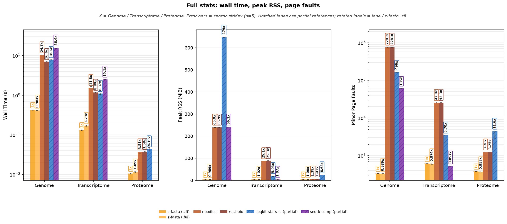
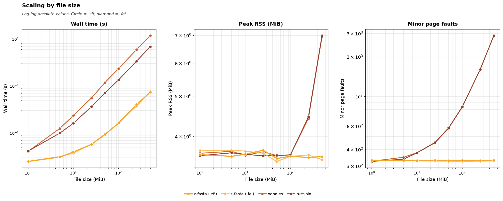
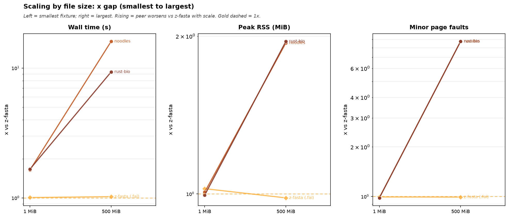
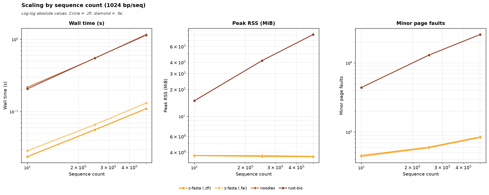
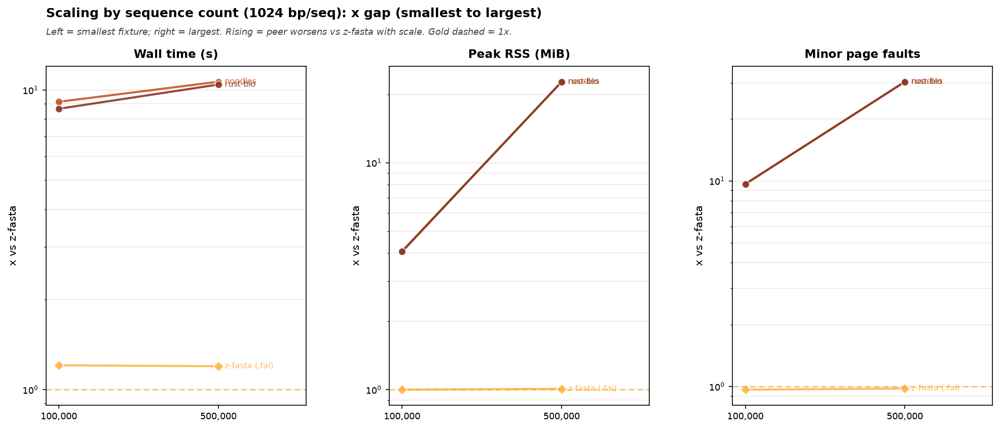

<!-- markdownlint-disable MD024 MD032 MD033 MD036 MD041 MD049 -->

# z-fasta Stats Benchmark Report

_Auto-generated by `bench/stats/generate_report.py` from zebrac results._

## Overview

This report times `z-fasta stats` against clean-FASTA peers on the shared REAL datasets (Genome, Transcriptome, Proteome) and on synthetic size / sequence-count sweeps.

**What is timed**

- **Complete stats:** `z-fasta stats` through `.zfi` and `.fai` vs noodles and rust-bio wrappers that emit the same agreed fields.
- **Partial references:** SeqKit `stats -a` covers assembly summaries and selected DNA composition; Seqtk `comp` covers per-record A/C/G/T/N composition on nucleotide data.
- **Scaling:** the two z-fasta formats plus the two complete Rust peers; partial references are intentionally excluded.

**Index policy:** sidecars are preloaded once. Timed commands only run `stats` / peer tools; index *build* is outside this wall (see `bench/index/REPORT.md`).

Correctness reported **66** passing checks before perf (see `bench/stats/run.sh`).

Correctness values are gated by the independent exact oracle in `bench/stats/oracle.py`, not re-tabulated here.

## What each tool reports

`z-fasta stats` reads length metadata from the selected sidecar, then scans sequence bytes for composition. Peers re-parse the FASTA every time.

### Assembly metrics (lengths / index)

| Metric | z-fasta | noodles | rust-bio | SeqKit `stats -a` | Seqtk `comp` |
| --- | --- | --- | --- | --- | --- |
| Records / total symbols | yes | yes | yes | yes | per-record lengths |
| Shortest / longest / mean / quartiles / median / range | yes | yes | yes | lengths except range | no |
| N50 / L50 / N90 / L90 / auN | yes | yes | yes | N50/L50 only | no |
| Shortest / longest names | yes | yes | yes | no | record names only |

### Composition (sequence scan)

| Metric | z-fasta | noodles | rust-bio | SeqKit `stats -a` | Seqtk `comp` |
| --- | --- | --- | --- | --- | --- |
| Nucleotide type / canonical bases / ambiguity / invalid | yes | yes | yes | type, N/gap totals | A/C/G/T/N plus other columns |
| GC / GC skew / lowercase | yes | yes | yes | GC only | GC derivable, no skew/lowercase |
| Complete protein symbols / stop / invalid / lowercase | yes | yes | yes | type only | no |

**How to read the benches:** Noodles and rust-bio are equivalent-work peers. SeqKit and Seqtk are useful ecosystem references but do less work and are never used for dominance claims. Wrappers are clean-FASTA peers only; messy side-table behavior is a z-fasta correctness gate.

Oracle: [`bench/stats/oracle.py`](oracle.py). Verify: [`bench/stats/run.sh`](run.sh) correctness (`run_tests`).

## Run Provenance

- **Timestamp:** `20261122_084711`
- **Runner:** zebrac (warm)
- **zebrac:** zebrac 0.6.2
- **z-fasta:** z-fasta 0.4.1
- **Samples:** runs=5, warmup=3, duration_ms=5000
- **Metadata:** `metadata_20261122_084711.jsonl`
- **Index preload:** True (build time not included in stats wall)

**Sections**

**Source and executable facts**

```json
{
  "checkout_revision": "52483244ac933df5e6f7901cb492c5059b5aa4ba",
  "checkout_dirty": true,
  "executable": {
    "path": "zig-out/bin/z-fasta",
    "size": 933608,
    "mtime_ns": 1795317893551889311,
    "ctime_ns": 1795318050878056176,
    "device": 50,
    "inode": 199116288
  },
  "declared_build": {
    "revision": null,
    "zig_version": "0.16.0",
    "optimize": "ReleaseFast",
    "target": "x86_64-linux.5.10...6.19-gnu.2.43"
  }
}
```

- `perf_full` -> `perf_full_20261122_084711`
- `scale_size` -> `scale_size_20261122_084711`
- `scale_seqs_fixed` -> `scale_seqs_fixed_20261122_084711`

**Peer versions**

- **seqkit:** seqkit v2.14.0
- **seqtk:** seqtk 1.5-r133
- **noodles:** noodles-fasta 0.69.0 (wrapper)
- **rustbio:** rust-bio 4.2.2 (custom indexer wrapper)
- **samtools:** samtools 1.25

- **Genome:** Homo sapiens GRCh38 primary assembly (Ensembl release 113).
- **Transcriptome:** Homo sapiens GENCODE v46 transcript sequences.
- **Proteome:** Homo sapiens UniProt reference proteome UP000005640.

## Performance: Full stats

Peers re-parse the FASTA. z-fasta loads one selected sidecar and performs a bounded FASTA scan for composition. Baseline for ratios: **z-fasta (.zfi)**. **Figure facets** are wall time, peak RSS, and minor page faults; **x-axis** is dataset; **bar color** is tool (GET RC layout).

## Wall time

Zebrac mean wall time (seconds) for one `stats` / peer process with stdout discarded.

**Table 1:** Mean ± stddev by dataset and tool.

| dataset       | z-fasta (.zfi)   | z-fasta (.fai)   | noodles        | rust-bio      | seqkit stats -a (partial)   | seqtk comp (partial)   |
|:--------------|:-----------------|:-----------------|:---------------|:--------------|:----------------------------|:-----------------------|
| Genome        | 0.421±0.003 s    | 0.414±0.005 s    | 10.391±0.075 s | 7.004±0.018 s | 7.848±0.043 s               | 15.406±0.183 s         |
| Transcriptome | 0.132±0.002 s    | 0.170±0.006 s    | 1.554±0.112 s  | 1.169±0.026 s | 1.101±0.050 s               | 2.516±0.021 s          |
| Proteome      | 0.011±0.000 s    | 0.011±0.000 s    | 0.037±0.002 s  | 0.038±0.001 s | 0.044±0.004 s               |                     |

<details><summary><strong>Table 2:</strong> Time x = lane wall / z-fasta .zfi. Same ratios as bar labels.</summary>

| Dataset       | z-fasta vs                | z-fasta   | Peer     | Time x   |
|:--------------|:--------------------------|:----------|:---------|:---------|
| Genome        | z-fasta (.fai)            | 0.4211s   | 0.4144s  | 0.984x   |
| Genome        | noodles                   | 0.4211s   | 10.3909s | 24.7x    |
| Genome        | rust-bio                  | 0.4211s   | 7.0040s  | 16.6x    |
| Genome        | seqkit stats -a (partial) | 0.4211s   | 7.8480s  | 18.6x    |
| Genome        | seqtk comp (partial)      | 0.4211s   | 15.4065s | 36.6x    |
| Transcriptome | z-fasta (.fai)            | 0.1315s   | 0.1700s  | 1.29x    |
| Transcriptome | noodles                   | 0.1315s   | 1.5544s  | 11.8x    |
| Transcriptome | rust-bio                  | 0.1315s   | 1.1693s  | 8.89x    |
| Transcriptome | seqkit stats -a (partial) | 0.1315s   | 1.1008s  | 8.37x    |
| Transcriptome | seqtk comp (partial)      | 0.1315s   | 2.5161s  | 19.1x    |
| Proteome      | z-fasta (.fai)            | 0.0105s   | 0.0114s  | 1.09x    |
| Proteome      | noodles                   | 0.0105s   | 0.0370s  | 3.51x    |
| Proteome      | rust-bio                  | 0.0105s   | 0.0377s  | 3.58x    |
| Proteome      | seqkit stats -a (partial) | 0.0105s   | 0.0441s  | 4.19x    |

</details>

<div style="margin: 1.5em 0"></div>

## Memory Usage

Peak RSS from zebrac samples for the same full-stats commands.

**Table 3:** Mean ± stddev by dataset and tool.

| dataset       | z-fasta (.zfi)   | z-fasta (.fai)   | noodles       | rust-bio      | seqkit stats -a (partial)   | seqtk comp (partial)   |
|:--------------|:-----------------|:-----------------|:--------------|:--------------|:----------------------------|:-----------------------|
| Genome        | 3.6±0.1 MiB      | 3.6±0.2 MiB      | 239.3±0.2 MiB | 239.4±0.0 MiB | 648.2±0.8 MiB               | 240.1±0.2 MiB          |
| Transcriptome | 3.5±0.1 MiB      | 3.6±0.1 MiB      | 87.7±0.1 MiB  | 88.5±0.1 MiB  | 20.7±3.6 MiB                | 3.7±0.1 MiB            |
| Proteome      | 3.6±0.1 MiB      | 3.6±0.1 MiB      | 5.0±0.0 MiB   | 5.1±0.1 MiB   | 24.0±4.3 MiB                |                     |

<details><summary><strong>Table 4:</strong> RSS x = lane peak RSS / z-fasta .zfi.</summary>

| Dataset       | z-fasta vs                | z-fasta   | Peer      | RSS x   |
|:--------------|:--------------------------|:----------|:----------|:--------|
| Genome        | z-fasta (.fai)            | 3.6 MiB   | 3.6 MiB   | 0.989x  |
| Genome        | noodles                   | 3.6 MiB   | 239.3 MiB | 65.9x   |
| Genome        | rust-bio                  | 3.6 MiB   | 239.4 MiB | 65.9x   |
| Genome        | seqkit stats -a (partial) | 3.6 MiB   | 648.2 MiB | 179x    |
| Genome        | seqtk comp (partial)      | 3.6 MiB   | 240.1 MiB | 66.1x   |
| Transcriptome | z-fasta (.fai)            | 3.5 MiB   | 3.6 MiB   | 1.02x   |
| Transcriptome | noodles                   | 3.5 MiB   | 87.7 MiB  | 25.1x   |
| Transcriptome | rust-bio                  | 3.5 MiB   | 88.5 MiB  | 25.3x   |
| Transcriptome | seqkit stats -a (partial) | 3.5 MiB   | 20.7 MiB  | 5.93x   |
| Transcriptome | seqtk comp (partial)      | 3.5 MiB   | 3.7 MiB   | 1.07x   |
| Proteome      | z-fasta (.fai)            | 3.6 MiB   | 3.6 MiB   | 1.00x   |
| Proteome      | noodles                   | 3.6 MiB   | 5.0 MiB   | 1.39x   |
| Proteome      | rust-bio                  | 3.6 MiB   | 5.1 MiB   | 1.42x   |
| Proteome      | seqkit stats -a (partial) | 3.6 MiB   | 24.0 MiB  | 6.68x   |

</details>

<div style="margin: 1.5em 0"></div>

## Page Faults

Minor page faults for the same full-stats commands.

**Table 5:** Mean ± stddev by dataset and tool.

| dataset       | z-fasta (.zfi)   | z-fasta (.fai)   | noodles   | rust-bio   | seqkit stats -a (partial)   | seqtk comp (partial)   |
|:--------------|:-----------------|:-----------------|:----------|:-----------|:----------------------------|:-----------------------|
| Genome        | 331±2            | 327±3            | 754933±2  | 754935±2   | 164198±73                   | 61215±3                |
| Transcriptome | 606±3            | 591±2            | 25483±2   | 25630±2    | 3456±1301                   | 520±2                  |
| Proteome      | 378±2            | 363±1            | 1234±2    | 1231±2     | 4394±1514                   |                     |

<details><summary><strong>Table 6:</strong> Faults x = lane minor faults / z-fasta .zfi.</summary>

| Dataset       | z-fasta vs                |   z-fasta |   Peer | Faults x   |
|:--------------|:--------------------------|----------:|-------:|:-----------|
| Genome        | z-fasta (.fai)            |       331 |    327 | 0.989x     |
| Genome        | noodles                   |       331 | 754933 | 2281x      |
| Genome        | rust-bio                  |       331 | 754935 | 2281x      |
| Genome        | seqkit stats -a (partial) |       331 | 164198 | 496x       |
| Genome        | seqtk comp (partial)      |       331 |  61215 | 185x       |
| Transcriptome | z-fasta (.fai)            |       606 |    591 | 0.974x     |
| Transcriptome | noodles                   |       606 |  25483 | 42.0x      |
| Transcriptome | rust-bio                  |       606 |  25630 | 42.3x      |
| Transcriptome | seqkit stats -a (partial) |       606 |   3456 | 5.70x      |
| Transcriptome | seqtk comp (partial)      |       606 |    520 | 0.857x     |
| Proteome      | z-fasta (.fai)            |       378 |    363 | 0.958x     |
| Proteome      | noodles                   |       378 |   1234 | 3.26x      |
| Proteome      | rust-bio                  |       378 |   1231 | 3.25x      |
| Proteome      | seqkit stats -a (partial) |       378 |   4394 | 11.6x      |

</details>

<div style="margin: 1.5em 0"></div>

**Figure 1:** Tables 1, 3, and 5 as grouped bars (datasets on x-axis; tool color from legend).



**Reading Figure 1**

- **Facets:** wall time (log y) | peak RSS (linear) | minor page faults (log y).
- **X-axis:** Genome, Transcriptome, Proteome.
- **Bar colors:** one lane per tool (legend below figure).
- **Bar labels (rotated):** `1x` on z-fasta; peers = peer / z-fasta. Same ratio rules on wall, RSS, and page faults.
- **Hatched bars:** partial-coverage SeqKit and Seqtk references; not equivalent-work dominance comparisons.
- Gold = z-fasta (`.zfi`); orange = z-fasta (`.fai`). Error bars show standard deviation.

<div style="margin: 1.5em 0"></div>

## Scaling: file size

Synthetic FASTAs under `bench/shared/cache/scaling/` (generated on demand). Indexes are preloaded; timed work is complete `stats` only. Two figures per sweep: absolute wall / RSS / faults, then whether the x vs z-fasta gap grows from the smallest fixture to the largest. Per-point x values stay in the collapsible tables.

**Table 7:** Mean ± stddev wall time by File size (MiB) and tool.

| File size (MiB)   | z-fasta (.zfi)   | z-fasta (.fai)   | noodles       | rust-bio      |
|:------------------|:-----------------|:-----------------|:--------------|:--------------|
| 1 MiB             | 2.50±0.08 ms     | 2.51±0.06 ms     | 4.10±0.17 ms  | 4.16±0.10 ms  |
| 5 MiB             | 3.10±0.11 ms     | 3.17±0.16 ms     | 0.013±0.001 s | 9.97±1.82 ms  |
| 10 MiB            | 3.96±0.19 ms     | 3.75±0.07 ms     | 0.024±0.001 s | 0.016±0.001 s |
| 25 MiB            | 5.74±0.08 ms     | 5.82±0.10 ms     | 0.056±0.002 s | 0.036±0.003 s |
| 50 MiB            | 9.42±0.15 ms     | 9.20±0.14 ms     | 0.119±0.008 s | 0.072±0.005 s |
| 100 MiB           | 0.016±0.000 s    | 0.017±0.001 s    | 0.236±0.010 s | 0.135±0.006 s |
| 250 MiB           | 0.041±0.001 s    | 0.038±0.001 s    | 0.595±0.023 s | 0.338±0.007 s |
| 500 MiB           | 0.074±0.001 s    | 0.075±0.002 s    | 1.180±0.019 s | 0.687±0.013 s |

<details><summary><strong>Table 8:</strong> Time x = peer / z-fasta at each point.</summary>

| File size (MiB)   | z-fasta vs     | z-fasta   | Peer    | Time x   |
|:------------------|:---------------|:----------|:--------|:---------|
| 1 MiB             | z-fasta (.fai) | 0.0025s   | 0.0025s | 1.01x    |
| 1 MiB             | noodles        | 0.0025s   | 0.0041s | 1.64x    |
| 1 MiB             | rust-bio       | 0.0025s   | 0.0042s | 1.66x    |
| 5 MiB             | z-fasta (.fai) | 0.0031s   | 0.0032s | 1.02x    |
| 5 MiB             | noodles        | 0.0031s   | 0.0126s | 4.06x    |
| 5 MiB             | rust-bio       | 0.0031s   | 0.0100s | 3.22x    |
| 10 MiB            | z-fasta (.fai) | 0.0040s   | 0.0038s | 0.947x   |
| 10 MiB            | noodles        | 0.0040s   | 0.0236s | 5.95x    |
| 10 MiB            | rust-bio       | 0.0040s   | 0.0162s | 4.08x    |
| 25 MiB            | z-fasta (.fai) | 0.0057s   | 0.0058s | 1.01x    |
| 25 MiB            | noodles        | 0.0057s   | 0.0556s | 9.68x    |
| 25 MiB            | rust-bio       | 0.0057s   | 0.0364s | 6.33x    |
| 50 MiB            | z-fasta (.fai) | 0.0094s   | 0.0092s | 0.977x   |
| 50 MiB            | noodles        | 0.0094s   | 0.1189s | 12.6x    |
| 50 MiB            | rust-bio       | 0.0094s   | 0.0715s | 7.59x    |
| 100 MiB           | z-fasta (.fai) | 0.0163s   | 0.0166s | 1.02x    |
| 100 MiB           | noodles        | 0.0163s   | 0.2356s | 14.5x    |
| 100 MiB           | rust-bio       | 0.0163s   | 0.1353s | 8.30x    |
| 250 MiB           | z-fasta (.fai) | 0.0406s   | 0.0377s | 0.928x   |
| 250 MiB           | noodles        | 0.0406s   | 0.5953s | 14.7x    |
| 250 MiB           | rust-bio       | 0.0406s   | 0.3379s | 8.33x    |
| 500 MiB           | z-fasta (.fai) | 0.0736s   | 0.0752s | 1.02x    |
| 500 MiB           | noodles        | 0.0736s   | 1.1805s | 16.0x    |
| 500 MiB           | rust-bio       | 0.0736s   | 0.6870s | 9.34x    |

</details>

<details><summary><strong>Table 9:</strong> Peak RSS (MiB) by File size (MiB).</summary>

| File size (MiB)   | z-fasta (.zfi)   | z-fasta (.fai)   | noodles     | rust-bio    |
|:------------------|:-----------------|:-----------------|:------------|:------------|
| 1 MiB             | 3.6±0.1 MiB      | 3.7±0.0 MiB      | 3.6±0.1 MiB | 3.6±0.1 MiB |
| 5 MiB             | 3.6±0.1 MiB      | 3.7±0.0 MiB      | 3.7±0.2 MiB | 3.7±0.1 MiB |
| 10 MiB            | 3.6±0.1 MiB      | 3.7±0.2 MiB      | 3.6±0.1 MiB | 3.6±0.1 MiB |
| 25 MiB            | 3.7±0.0 MiB      | 3.6±0.1 MiB      | 3.7±0.0 MiB | 3.6±0.1 MiB |
| 50 MiB            | 3.5±0.1 MiB      | 3.5±0.1 MiB      | 3.6±0.2 MiB | 3.6±0.1 MiB |
| 100 MiB           | 3.6±0.1 MiB      | 3.6±0.2 MiB      | 3.6±0.1 MiB | 3.6±0.1 MiB |
| 250 MiB           | 3.6±0.2 MiB      | 3.6±0.1 MiB      | 4.4±0.1 MiB | 4.5±0.1 MiB |
| 500 MiB           | 3.6±0.1 MiB      | 3.5±0.1 MiB      | 6.9±0.1 MiB | 7.0±0.1 MiB |

</details>

<details><summary><strong>Table 10:</strong> RSS x = peer / z-fasta.</summary>

| File size (MiB)   | z-fasta vs     | z-fasta   | Peer    | RSS x   |
|:------------------|:---------------|:----------|:--------|:--------|
| 1 MiB             | z-fasta (.fai) | 3.6 MiB   | 3.7 MiB | 1.02x   |
| 1 MiB             | noodles        | 3.6 MiB   | 3.6 MiB | 1.01x   |
| 1 MiB             | rust-bio       | 3.6 MiB   | 3.6 MiB | 0.994x  |
| 5 MiB             | z-fasta (.fai) | 3.6 MiB   | 3.7 MiB | 1.03x   |
| 5 MiB             | noodles        | 3.6 MiB   | 3.7 MiB | 1.03x   |
| 5 MiB             | rust-bio       | 3.6 MiB   | 3.7 MiB | 1.02x   |
| 10 MiB            | z-fasta (.fai) | 3.6 MiB   | 3.7 MiB | 1.02x   |
| 10 MiB            | noodles        | 3.6 MiB   | 3.6 MiB | 0.993x  |
| 10 MiB            | rust-bio       | 3.6 MiB   | 3.6 MiB | 0.999x  |
| 25 MiB            | z-fasta (.fai) | 3.7 MiB   | 3.6 MiB | 0.983x  |
| 25 MiB            | noodles        | 3.7 MiB   | 3.7 MiB | 0.992x  |
| 25 MiB            | rust-bio       | 3.7 MiB   | 3.6 MiB | 0.969x  |
| 50 MiB            | z-fasta (.fai) | 3.5 MiB   | 3.5 MiB | 0.984x  |
| 50 MiB            | noodles        | 3.5 MiB   | 3.6 MiB | 1.02x   |
| 50 MiB            | rust-bio       | 3.5 MiB   | 3.6 MiB | 1.02x   |
| 100 MiB           | z-fasta (.fai) | 3.6 MiB   | 3.6 MiB | 0.999x  |
| 100 MiB           | noodles        | 3.6 MiB   | 3.6 MiB | 1.01x   |
| 100 MiB           | rust-bio       | 3.6 MiB   | 3.6 MiB | 1.01x   |
| 250 MiB           | z-fasta (.fai) | 3.6 MiB   | 3.6 MiB | 1.01x   |
| 250 MiB           | noodles        | 3.6 MiB   | 4.4 MiB | 1.24x   |
| 250 MiB           | rust-bio       | 3.6 MiB   | 4.5 MiB | 1.25x   |
| 500 MiB           | z-fasta (.fai) | 3.6 MiB   | 3.5 MiB | 0.983x  |
| 500 MiB           | noodles        | 3.6 MiB   | 6.9 MiB | 1.94x   |
| 500 MiB           | rust-bio       | 3.6 MiB   | 7.0 MiB | 1.95x   |

</details>

<details><summary><strong>Table 11:</strong> Minor page faults by File size (MiB).</summary>

| File size (MiB)   | z-fasta (.zfi)   | z-fasta (.fai)   | noodles   | rust-bio   |
|:------------------|:-----------------|:-----------------|:----------|:-----------|
| 1 MiB             | 331±0            | 329±2            | 325±3     | 324±2      |
| 5 MiB             | 330±2            | 328±1            | 349±1     | 337±3      |
| 10 MiB            | 329±2            | 327±2            | 377±4     | 376±3      |
| 25 MiB            | 331±2            | 326±3            | 448±2     | 451±3      |
| 50 MiB            | 329±2            | 326±2            | 578±2     | 582±2      |
| 100 MiB           | 331±1            | 325±2            | 834±5     | 837±2      |
| 250 MiB           | 329±2            | 326±2            | 1607±2    | 1603±3     |
| 500 MiB           | 330±3            | 327±3            | 2886±2    | 2884±2     |

</details>

<details><summary><strong>Table 12:</strong> Faults x = peer / z-fasta.</summary>

| File size (MiB)   | z-fasta vs     |   z-fasta |   Peer | Faults x   |
|:------------------|:---------------|----------:|-------:|:-----------|
| 1 MiB             | z-fasta (.fai) |       331 |    329 | 0.993x     |
| 1 MiB             | noodles        |       331 |    325 | 0.984x     |
| 1 MiB             | rust-bio       |       331 |    324 | 0.981x     |
| 5 MiB             | z-fasta (.fai) |       330 |    328 | 0.996x     |
| 5 MiB             | noodles        |       330 |    349 | 1.06x      |
| 5 MiB             | rust-bio       |       330 |    337 | 1.02x      |
| 10 MiB            | z-fasta (.fai) |       329 |    327 | 0.996x     |
| 10 MiB            | noodles        |       329 |    377 | 1.15x      |
| 10 MiB            | rust-bio       |       329 |    376 | 1.14x      |
| 25 MiB            | z-fasta (.fai) |       331 |    326 | 0.987x     |
| 25 MiB            | noodles        |       331 |    448 | 1.36x      |
| 25 MiB            | rust-bio       |       331 |    451 | 1.36x      |
| 50 MiB            | z-fasta (.fai) |       329 |    326 | 0.991x     |
| 50 MiB            | noodles        |       329 |    578 | 1.76x      |
| 50 MiB            | rust-bio       |       329 |    582 | 1.77x      |
| 100 MiB           | z-fasta (.fai) |       331 |    325 | 0.982x     |
| 100 MiB           | noodles        |       331 |    834 | 2.52x      |
| 100 MiB           | rust-bio       |       331 |    837 | 2.53x      |
| 250 MiB           | z-fasta (.fai) |       329 |    326 | 0.991x     |
| 250 MiB           | noodles        |       329 |   1607 | 4.88x      |
| 250 MiB           | rust-bio       |       329 |   1603 | 4.87x      |
| 500 MiB           | z-fasta (.fai) |       330 |    327 | 0.992x     |
| 500 MiB           | noodles        |       330 |   2886 | 8.75x      |
| 500 MiB           | rust-bio       |       330 |   2884 | 8.74x      |

</details>

<div style="margin: 1.5em 0"></div>

**Figure 2:** Absolute wall / RSS / page faults vs File size (MiB) (log-log).



**Reading Figure 2**

- **Facets:** wall time | peak RSS | minor page faults (log-log).
- **X:** File size (MiB). Gold circle = `.zfi`; orange diamond = `.fai`.
- RSS is log-scaled to show both index formats clearly.
- Per-point x vs z-fasta: open the Time / RSS / Faults x tables above.

<div style="margin: 1.5em 0"></div>

**Figure 3:** x vs z-fasta at the smallest vs largest fixture.



**Reading Figure 3**

- Left = smallest fixture; right = largest. Gold dashed = 1x.
- Rising = peer gets relatively worse with scale; falling = relatively better.

<div style="margin: 1.5em 0"></div>

## Scaling: sequence count (fixed 1024 bp)

Synthetic FASTAs under `bench/shared/cache/scaling/` (generated on demand). Indexes are preloaded; timed work is complete `stats` only. Two figures per sweep: absolute wall / RSS / faults, then whether the x vs z-fasta gap grows from the smallest fixture to the largest. Per-point x values stay in the collapsible tables.

**Table 13:** Mean ± stddev wall time by Sequence count and tool.

|   Sequence count | z-fasta (.zfi)   | z-fasta (.fai)   | noodles       | rust-bio      |
|-----------------:|:-----------------|:-----------------|:--------------|:--------------|
|          100,000 | 0.024±0.000 s    | 0.029±0.002 s    | 0.218±0.011 s | 0.207±0.003 s |
|          250,000 | 0.056±0.000 s    | 0.066±0.001 s    | 0.550±0.003 s | 0.554±0.008 s |
|          500,000 | 0.110±0.002 s    | 0.131±0.004 s    | 1.170±0.030 s | 1.145±0.024 s |

<details><summary><strong>Table 14:</strong> Time x = peer / z-fasta at each point.</summary>

|   Sequence count | z-fasta vs     | z-fasta   | Peer    | Time x   |
|-----------------:|:---------------|:----------|:--------|:---------|
|          100,000 | z-fasta (.fai) | 0.0239s   | 0.0288s | 1.21x    |
|          100,000 | noodles        | 0.0239s   | 0.2180s | 9.14x    |
|          100,000 | rust-bio       | 0.0239s   | 0.2067s | 8.66x    |
|          250,000 | z-fasta (.fai) | 0.0563s   | 0.0662s | 1.18x    |
|          250,000 | noodles        | 0.0563s   | 0.5498s | 9.76x    |
|          250,000 | rust-bio       | 0.0563s   | 0.5539s | 9.84x    |
|          500,000 | z-fasta (.fai) | 0.1098s   | 0.1314s | 1.20x    |
|          500,000 | noodles        | 0.1098s   | 1.1700s | 10.7x    |
|          500,000 | rust-bio       | 0.1098s   | 1.1449s | 10.4x    |

</details>

<details><summary><strong>Table 15:</strong> Peak RSS (MiB) by Sequence count.</summary>

|   Sequence count | z-fasta (.zfi)   | z-fasta (.fai)   | noodles      | rust-bio     |
|-----------------:|:-----------------|:-----------------|:-------------|:-------------|
|          100,000 | 3.7±0.2 MiB      | 3.7±0.2 MiB      | 14.9±0.0 MiB | 15.0±0.1 MiB |
|          250,000 | 3.6±0.2 MiB      | 3.7±0.0 MiB      | 41.7±0.2 MiB | 41.8±0.2 MiB |
|          500,000 | 3.6±0.1 MiB      | 3.6±0.1 MiB      | 81.5±0.0 MiB | 81.3±0.2 MiB |

</details>

<details><summary><strong>Table 16:</strong> RSS x = peer / z-fasta.</summary>

|   Sequence count | z-fasta vs     | z-fasta   | Peer     | RSS x   |
|-----------------:|:---------------|:----------|:---------|:--------|
|          100,000 | z-fasta (.fai) | 3.7 MiB   | 3.7 MiB  | 1.00x   |
|          100,000 | noodles        | 3.7 MiB   | 14.9 MiB | 4.05x   |
|          100,000 | rust-bio       | 3.7 MiB   | 15.0 MiB | 4.07x   |
|          250,000 | z-fasta (.fai) | 3.6 MiB   | 3.7 MiB  | 1.02x   |
|          250,000 | noodles        | 3.6 MiB   | 41.7 MiB | 11.6x   |
|          250,000 | rust-bio       | 3.6 MiB   | 41.8 MiB | 11.6x   |
|          500,000 | z-fasta (.fai) | 3.6 MiB   | 3.6 MiB  | 1.01x   |
|          500,000 | noodles        | 3.6 MiB   | 81.5 MiB | 22.8x   |
|          500,000 | rust-bio       | 3.6 MiB   | 81.3 MiB | 22.7x   |

</details>

<details><summary><strong>Table 17:</strong> Minor page faults by Sequence count.</summary>

|   Sequence count | z-fasta (.zfi)   | z-fasta (.fai)   | noodles   | rust-bio   |
|-----------------:|:-----------------|:-----------------|:----------|:-----------|
|          100,000 | 457±2            | 441±3            | 4417±1    | 4414±2     |
|          250,000 | 603±2            | 590±2            | 13029±2   | 13026±2    |
|          500,000 | 849±2            | 831±2            | 25784±4   | 25776±2    |

</details>

<details><summary><strong>Table 18:</strong> Faults x = peer / z-fasta.</summary>

|   Sequence count | z-fasta vs     |   z-fasta |   Peer | Faults x   |
|-----------------:|:---------------|----------:|-------:|:-----------|
|          100,000 | z-fasta (.fai) |       457 |    441 | 0.965x     |
|          100,000 | noodles        |       457 |   4417 | 9.66x      |
|          100,000 | rust-bio       |       457 |   4414 | 9.65x      |
|          250,000 | z-fasta (.fai) |       603 |    590 | 0.978x     |
|          250,000 | noodles        |       603 |  13029 | 21.6x      |
|          250,000 | rust-bio       |       603 |  13026 | 21.6x      |
|          500,000 | z-fasta (.fai) |       849 |    831 | 0.978x     |
|          500,000 | noodles        |       849 |  25784 | 30.4x      |
|          500,000 | rust-bio       |       849 |  25776 | 30.3x      |

</details>

<div style="margin: 1.5em 0"></div>

**Figure 4:** Absolute wall / RSS / page faults vs Sequence count (log-log).



**Reading Figure 4**

- **Facets:** wall time | peak RSS | minor page faults (log-log).
- **X:** Sequence count. Gold circle = `.zfi`; orange diamond = `.fai`.
- RSS is log-scaled to show both index formats clearly.
- Per-point x vs z-fasta: open the Time / RSS / Faults x tables above.

<div style="margin: 1.5em 0"></div>

**Figure 5:** x vs z-fasta at the smallest vs largest fixture.



**Reading Figure 5**

- Left = smallest fixture; right = largest. Gold dashed = 1x.
- Rising = peer gets relatively worse with scale; falling = relatively better.

<div style="margin: 1.5em 0"></div>
